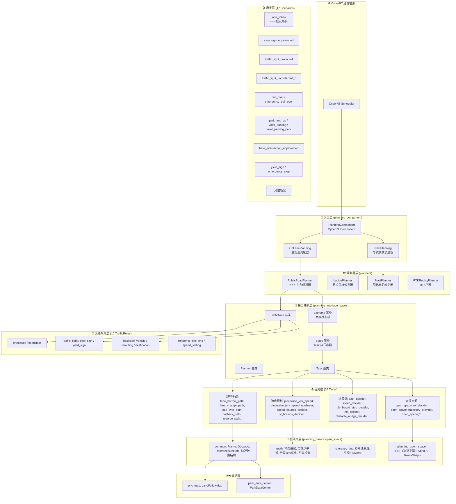
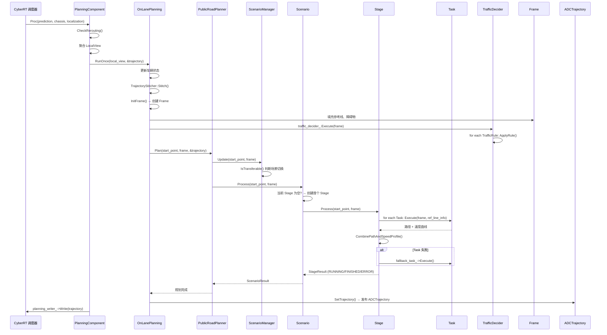

# Apollo PnC 赛事工程 — 系统架构总览

> 生成时间：2026-06-16 | 分析覆盖：779 源码文件 / ~130,976 行

---

## 一、系统整体架构



---

## 二、模块职责矩阵

| 模块 | 文件数 | 代码行 | 核心职责 | 关键类 |
|------|--------|--------|----------|--------|
| **planning_component** | 14 | ~3,700 | CyberRT 入口，数据聚合，调度 Planner | `PlanningComponent`, `OnLanePlanning`, `NaviPlanning` |
| **planning_interface_base** | 53 | ~4,500 | 定义 Planner/Scenario/Stage/Task/TrafficRule 抽象接口 | `Planner`, `Scenario`, `Stage`, `Task`, `TrafficRule`, `TrafficDecider` |
| **planners/public_road** | 6 | ~350 | 主力规划器，场景管理 | `PublicRoadPlanner`, `ScenarioManager` |
| **planners/lattice** | 28 | ~3,613 | Frenet 采样 + 代价评估 | `LatticePlanner`, `Trajectory1dGenerator`, `TrajectoryEvaluator` |
| **planners/navi** | 19 | ~3,975 | 无高精地图简化规划 | `NaviPlanner`, `NaviPathDecider`, `NaviSpeedDecider` |
| **planners/rtk** | 3 | ~424 | RTK 轨迹回放 | `RTKReplayPlanner` |
| **scenarios** | 178 | ~12,000 | 17 个驾驶场景，每个含 Scenario + Stage 实现 | 17 个 Scenario 类 + 对应 Stage 类 |
| **tasks** | 138 | ~27,000 | 35 个可复用规划任务 | 路径生成/速度规划/决策/开放空间 4 大类 |
| **traffic_rules** | 29 | ~2,300 | 10 个交通规则检查器 | `Crosswalk`, `TrafficLight`, `StopSign`, `YieldSign`... |
| **planning_base/common** | 101 | ~15,708 | 核心数据结构 | `Frame`, `ReferenceLineInfo`, `Obstacle`, `DiscretizedTrajectory` |
| **planning_base/math** | 79 | ~12,942 | 数学库（样条/平滑/优化） | `Spline2d`, `PiecewiseJerkProblem`, `FemPosDeviationSmoother` |
| **planning_base/reference_line** | 20 | ~5,481 | 参考线生成与平滑 | `ReferenceLine`, `ReferenceLineProvider`, `SpiralReferenceLineSmoother` |
| **planning_open_space** | 53 | ~23,500 | 开放空间规划（IPOPT/Hybrid A*） | `HybridAStar`, `DistanceApproachInterface`, `IterativeAnchoringSmoother` |
| **pnc_map** | 3 | ~1,381 | PnC 地图查询 | `LaneFollowMap` |
| **park_data_center** | 5 | ~472 | 泊车数据管理 | `ParkDataCenter` |

---

## 三、核心数据流



---

## 四、Scenario-Stage 两级状态机

```mermaid
stateDiagram-v2
    [*] --> UNKNOWN: Scenario 初始化
    UNKNOWN --> PROCESSING: 首个 Stage 创建成功
    PROCESSING --> PROCESSING: Stage::RUNNING (保持)
    PROCESSING --> PROCESSING: Stage::FINISHED, next_stage 非空 → 切换 Stage
    PROCESSING --> DONE: Stage::FINISHED, next_stage 为空
    PROCESSING --> UNKNOWN: Stage::ERROR
    
    state Stage内部 {
        [*] --> READY: Stage::Init()
        READY --> RUNNING: Stage::Process() 首次调用
        RUNNING --> RUNNING: Task 执行成功, 未完成
        RUNNING --> FINISHED: 所有 Task 完成
        RUNNING --> ERROR: 某 Task 失败 (fallback 未拯救)
    }
```

---

## 五、关键技术栈

| 层级 | 技术 | 用途 |
|------|------|------|
| **通信框架** | CyberRT (百度自研) | 组件调度、消息发布/订阅、插件管理 |
| **构建系统** | Bazel + buildtool | 编译构建、依赖管理 |
| **配置管理** | Protobuf (.pb.txt) | 插件配置、pipeline 定义 |
| **插件体系** | Cyber PluginManager | Planner/Scenario/Stage/Task/TrafficRule 动态加载 |
| **优化求解器** | OSQP, IPOPT | QP 路径平滑、NLP 速度优化、轨迹平滑 |
| **路径规划** | Hybrid A*, Reed-Shepp | 开放空间粗轨迹生成 |
| **样条曲线** | 1D/2D Spline (OSQP) | 参考线平滑、路径平滑 |
| **速度规划** | 分段 Jerk (QP/NLP) | 速度曲线优化 |
| **行为决策** | DP 网格搜索 + 代价评估 | S-T 图路径搜索 |
| **安全约束** | RSS (ad_rss 库) | 责任敏感安全距离 |
| **地图** | HDMap (LaneFollowMap) | 车道/参考线/路口查询 |
| **学习模型** | 鸟瞰图渲染 | 学习-based 规划特征 |

---

## 六、设计模式应用

| 设计模式 | 应用位置 | 说明 |
|----------|----------|------|
| **策略模式** | Planner 体系 (`PlanningBase → OnLanePlanning/NaviPlanning`) | 运行时选择规划策略 |
| **工厂模式** | PluginManager 创建 Scenario/Stage/Task/TrafficRule | 配置驱动插件实例化 |
| **状态模式** | Scenario-Stage 两级状态机 | 场景切换只通过状态转换 |
| **模板方法** | `Stage::ExecuteTaskOnReferenceLine()` → `Task::Execute()` | Stage 定义流程骨架，Task 实现具体步骤 |
| **责任链** | `TrafficDecider::rule_list_` 顺序执行 | 交通规则串联检查 |
| **单例模式** | `ParkDataCenter::Instance()` | 全局泊车数据访问 |
| **观察者模式** | CyberRT Reader 回调 | 异步消息接收 |
| **命令模式** | Task 插件 (`Task::Execute()`) | 封装规划操作为可复用命令 |

---

## 七、全局风险评估

| 风险级别 | 描述 | 涉及模块 |
|----------|------|----------|
| 🔴 **高** | `indexed_queue.h` 核心成员 public，封装完全破坏，queue/map 一致性无保障 | planning_base/common |
| 🔴 **高** | `dual_variable_warm_start_problem.h` 和 `hybrid_a_star.h` 双构造函数 + `// park generic` 场景特化代码混入通用类 | planning_open_space |
| 🟡 **中** | `frame.h` 中 `hdmap_` 裸指针无生命周期保障，`pad_msg_driving_action_` static 成员跨实例共享 | planning_base/common |
| 🟡 **中** | `distance_approach_interface.h` 使用 `#define` 宏造成全局命名空间污染 | planning_open_space |
| 🟢 **低** | `DiscretizedTrajectory::Evaluate()` 按值返回 Protobuf，高频调用性能开销 | planning_base/common |
| 🟢 **低** | 多处英文拼写错误 (forth→fourth, neightbor→neighbor) | tasks |
| ℹ️ **信息** | `PlanningBase::Init()` 和 `Planner::Init()` 有默认实现非纯虚，文档标注为"纯虚"属事实错误 | planning_component, interface_base |

---

## 八、赛事场景扩展指南

基于现有架构，新增赛事场景的标准步骤：

1. **创建 Scenario 类**：继承 `Scenario`，实现 `IsTransferable()` 判断进入条件
2. **创建 Stage 类**：继承 `Stage`（或 `BaseStageCreep`/`BaseStageCruise`），实现 `Process()`
3. **配置 pipeline.pb.txt**：定义 Stage 执行顺序和 Task 列表
4. **注册插件**：`CYBER_PLUGIN_MANAGER_REGISTER_PLUGIN` 宏注册
5. **声明可使用 Scenario**：在 `ScenarioManager` 的 Planner 配置中添加

> **注意**：避免在通用类中通过注释 `// park generic` 等方式混入场景特化逻辑，应通过继承或策略模式解耦。

---

*本文档由 AI 总指挥（Orchestrator）协调 32 个分析 Agent + 32 个审查 Agent 生成*
