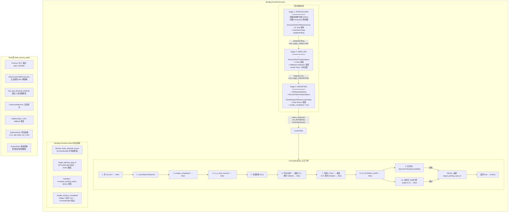
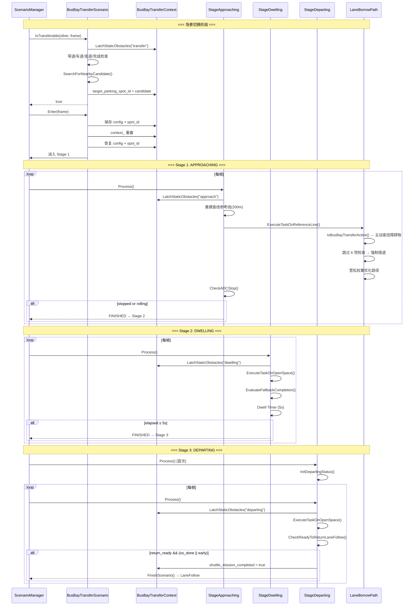

# BusBayTransferScenario（站点接驳场景）完整分析报告

> 生成日期：2026-06-23
> 分析方式：4 路子 Agent 并行分析 + 交叉验证
> 分析范围：Scenario 层 × Stage 层 × Task 层

---

## 目录

1. [场景概览](#1-场景概览)
2. [代码文件索引](#2-代码文件索引)
3. [数据结构：BusBayTransferContext](#3-数据结构busbaytransfercontext)
4. [配置：ScenarioBusBayTransferConfig](#4-配置scenariobaytransferconfig)
5. [Scenario 层生命周期](#5-scenario-层生命周期)
   - [5.1 Init()](#51-init)
   - [5.2 Enter()](#52-enter)
   - [5.3 IsTransferable() — 核心转移判定](#53-istransferable--核心转移判定)
6. [三阶段状态机](#6-三阶段状态机)
   - [6.1 Stage 1: APPROACHING（直道逼近泊位）](#61-stage-1-approaching直道逼近泊位)
   - [6.2 Stage 2: DWELLING（泊位驻留）](#62-stage-2-dwelling泊位驻留)
   - [6.3 Stage 3: DEPARTING（泊位驶离）](#63-stage-3-departing泊位驶离)
7. [Task 层集成逻辑](#7-task-层集成逻辑)
   - [7.1 Bus Bay 场景检测](#71-bus-bay-场景检测)
   - [7.2 主动障碍物查找](#72-主动障碍物查找)
   - [7.3 借道触发条件放宽](#73-借道触发条件放宽)
   - [7.4 路径边界宽松](#74-路径边界宽松)
   - [7.5 优化器权重修改](#75-优化器权重修改)
   - [7.6 路径评估保底](#76-路径评估保底)
8. [lane_borrow_path vs lane_borrow_path_generic 差异](#8-lane_borrow_path-vs-lane_borrow_path_generic-差异)
9. [关键常量速查表](#9-关键常量速查表)
10. [状态修改完整总结](#10-状态修改完整总结)
11. [交叉验证发现的问题](#11-交叉验证发现的问题)
12. [完整 Mermaid 状态图](#12-完整-mermaid-状态图)

---

## 1. 场景概览

**BusBayTransferScenario（站点接驳场景）** 实现了公交车在公交港湾（bus bay）的停靠、驻留和驶离全流程。

```
  LaneFollow ──► APPROACHING ──► DWELLING ──► DEPARTING ──► LaneFollow
                  (逼近泊位)       (驻留5秒)      (驶离泊位)
```

**核心设计理念**：
- 使用 **OpenSpace** 规划管线完成精确泊入/泊出
- 通过 **latch 机制** 跨帧记忆静态障碍物
- 在 Task 层大量**绕过常规限制**，确保借道绕行行为不被常规交通规则阻止

---

## 2. 代码文件索引

| 层级 | 文件 | 绝对路径 |
|------|------|----------|
| **Proto** | bus_bay_transfer.proto | `modules/planning/scenarios/valet_parking/proto/bus_bay_transfer.proto` |
| **Scenario** | bus_bay_transfer_scenario.h | `modules/planning/scenarios/valet_parking/bus_bay_transfer_scenario.h` |
| **Scenario** | bus_bay_transfer_scenario.cc | `modules/planning/scenarios/valet_parking/bus_bay_transfer_scenario.cc` |
| **Stage 1** | stage_approaching_bus_bay.h | `modules/planning/scenarios/valet_parking/stage_approaching_bus_bay.h` |
| **Stage 1** | stage_approaching_bus_bay.cc | `modules/planning/scenarios/valet_parking/stage_approaching_bus_bay.cc` |
| **Stage 2** | stage_dwelling_at_bus_bay.h | `modules/planning/scenarios/valet_parking/stage_dwelling_at_bus_bay.h` |
| **Stage 2** | stage_dwelling_at_bus_bay.cc | `modules/planning/scenarios/valet_parking/stage_dwelling_at_bus_bay.cc` |
| **Stage 3** | stage_departing_from_bus_bay.h | `modules/planning/scenarios/valet_parking/stage_departing_from_bus_bay.h` |
| **Stage 3** | stage_departing_from_bus_bay.cc | `modules/planning/scenarios/valet_parking/stage_departing_from_bus_bay.cc` |
| **Task** | lane_borrow_path.cc | `modules/planning/tasks/lane_borrow_path/lane_borrow_path.cc` |
| **Task** | lane_borrow_path_generic.cc | `modules/planning/tasks/lane_borrow_path_generic/lane_borrow_path_generic.cc` |

---

## 3. 数据结构：BusBayTransferContext

```cpp
struct BusBayTransferContext : public ScenarioContext {
    ScenarioBusBayTransferConfig scenario_config;       // protobuf 配置
    std::string target_parking_spot_id;                  // 目标停车位 ID
    bool pre_stop_rightaway_flag = false;                // 是否需要立即预停车
    hdmap::MapPathPoint pre_stop_rightaway_point;        // 预停车点坐标
    bool shuttle_mission_completed = false;              // 接驳任务是否已完成
    std::vector<common::math::Box2d> latched_static_obstacle_boxes;  // 锁存的障碍物包围盒

    void LatchStaticObstacles(const Frame& frame, const std::string& source);
    void InjectLatchedStaticObstacles(Frame* frame) const;
};
```

### 3.1 字段作用详解

| 字段 | 初始值 | 生命周期 | 作用 |
|------|--------|----------|------|
| `scenario_config` | 默认值 → 配置文件 | 跨 Enter() 保留 | 存储 `parking_spot_range_to_start` 和 `max_valid_stop_distance` |
| `target_parking_spot_id` | `""` → `IsTransferable()` 设定 | 跨 Enter() 保留 | 被所有 3 个 Stage 使用 |
| `pre_stop_rightaway_flag` | `false` | Enter() 重置 | 标记是否需要在公交港入口立即预停 |
| `pre_stop_rightaway_point` | 默认构造 | Enter() 重置 | 预停点的地图坐标 |
| `shuttle_mission_completed` | `false` → Stage 3 设为 true | Enter() 重置 | 防止重复进入场景 |
| `latched_static_obstacle_boxes` | `{}` | Enter() 重置 | ⚠️ 跨帧记忆的静态障碍物列表 |

### 3.2 LatchStaticObstacles() — 锁存机制

**目的**：在公交港场景中，车辆驶入窄车道后感知可能丢失已走过的障碍物。Latch 机制跨帧"记住"这些障碍物。

**逐步骤逻辑**：

1. **遍历 `frame.obstacles()` 中所有障碍物**
2. **过滤条件**：
   - 跳过 `nullptr`
   - 跳过虚拟障碍物（`IsVirtual()`）
   - 跳过非静态障碍物（`!IsStatic()`）
   - 跳过距离 ADC > 40m 的障碍物
3. **合并（Merge）**：`TryMergeIntoLatched()` 与已锁存列表逐个匹配
   - **匹配条件**：中心距离 < 0.8m **且** 朝向差 < 0.35 rad（≈20°）
   - 若匹配：用新 box 替换旧 box（位置更新）
4. **新增**：`AddNewLatchedBox()` — 最多存储 16 个 box

### 3.3 InjectLatchedStaticObstacles() — ⚠️ 空操作

```cpp
void BusBayTransferContext::InjectLatchedStaticObstacles(Frame* frame) const {
    if (frame == nullptr || latched_static_obstacle_boxes.empty()) return;
    AINFO << "Bus-bay: skip replaying latched obstacles, count="
          << latched_static_obstacle_boxes.size()
          << ", visible=" << frame->obstacles().size();
}
```

**⚠️ 交叉验证发现：此函数是空操作（存根）！** 它只打印日志，不实际注入障碍物到 Frame。当前版本中 Stage 2 和 Stage 3 的锁存障碍物**不会被 OpenSpace 规划器使用**。这是一个预留的扩展点。

---

## 4. 配置：ScenarioBusBayTransferConfig

```protobuf
message ScenarioBusBayTransferConfig {
    optional double parking_spot_range_to_start = 1 [default = 20.0];  // 米
    optional double max_valid_stop_distance = 2 [default = 1.0];       // 米
}
```

| 参数 | 默认值 | 使用位置 | 含义 |
|------|--------|----------|------|
| `parking_spot_range_to_start` | **20.0m** | `Scenario::CheckDistanceToParkingSpot()` | 自车与目标停车位沿路径距离 < 此值时，允许进入 Scenario |
| `max_valid_stop_distance` | **1.0m** | `StageApproachingBusBay::CheckADCStop()` | 自车与预停点距离 < 此值时，判定停车完成 |

---

## 5. Scenario 层生命周期

### 5.1 Init()

```
调用时机：插件加载后由 ScenarioManager 调用
```

**执行步骤**：

| 步骤 | 操作 | 状态变化 |
|------|------|----------|
| 1 | 幂等检查：`init_ == true` → 直接返回 | — |
| 2 | `Scenario::Init(injector, name)` | 注册依赖注入、设置名称 |
| 3 | `LoadConfig<ScenarioBusBayTransferConfig>(&context_.scenario_config)` | `context_.scenario_config`：默认值 → 配置文件值 |
| 4 | `hdmap_ = HDMapUtil::BaseMapPtr()` | `hdmap_`：`nullptr` → 全局高精地图指针 |
| 5 | `init_ = true` | `init_`：`false` → `true` |

### 5.2 Enter()

```
调用时机：IsTransferable() 返回 true 后，ScenarioManager 调用
```

**执行步骤**：

| 步骤 | 操作 | 状态变化 |
|------|------|----------|
| 1 | 保存 `saved_config` = `context_.scenario_config` | — |
| 2 | 保存 `saved_spot_id` = `context_.target_parking_spot_id` | — |
| 3 | `context_ = BusBayTransferContext()` | **全部重置**：所有字段回归初始值 |
| 4 | `context_.scenario_config.CopyFrom(saved_config)` | 恢复 protobuf 配置 |
| 5 | `context_.target_parking_spot_id = saved_spot_id` | 恢复目标停车位 ID |
| 6 | `forbiden.clear()` | `forbiden`：任意 → `{}` |
| 7 | `occupied_parking_spots_.clear()` | `occupied_parking_spots_`：任意 → `{}` |
| 8 | `Scenario::Enter(frame)` | 触发基类进入逻辑 |

**关键设计**：保留 `scenario_config` 和 `target_parking_spot_id`（跨进入需要），重置其余所有运行时状态（全新进入）。

### 5.3 IsTransferable() — 核心转移判定

这是整个场景的**入口门控**，每帧由 ScenarioManager 调用。以下按代码执行顺序列出每一步：

```
入口：IsTransferable(other_scenario, frame)
```

#### 第 1 步：空 ReferenceLine 检查
```cpp
if (frame.reference_line_info().empty()) → return false
```
- **状态变化**：无
- **含义**：没有参考线，后续所有计算都无法进行

#### 第 2 步：更新锁存障碍物
```cpp
context_.LatchStaticObstacles(frame, "transfer");
```
- **状态变化**：`context_.latched_static_obstacle_boxes` 被 Merge/Append 更新

#### 第 3 步：接驳任务完成检查
```cpp
if (context_.shuttle_mission_completed) → return false
```
- **状态变化**：无
- **含义**：接驳已完成，不再进入（`shuttle_mission_completed` 由 Stage 3 设为 true）

#### 第 4 步：借道绕行冲突检查
```cpp
if (is_in_path_lane_borrow_scenario) → return false
```
- **含义**：当前正在执行借道绕行中，不打断

#### 第 5 步：车道查找
```cpp
HDMapUtil::BaseMap().GetNearestLaneWithDistance(adc_pt, 5.0, &lane, &s, &l);
```
- 5 米搜索半径内查找最近车道

#### 第 6 步：不在车道上的处理
```cpp
if (lane == nullptr || !lane->IsOnLane({adc_pt.x(), adc_pt.y()})) {
    if (speed < 0.2) → forbiden 批量填充 → return false
}
```
- **状态变化**：`forbiden` 批量插入所有 nearby parking_space_overlaps 的 object_id
- **条件**：速度 < 0.2 m/s（几乎静止）

#### 第 7 步：窄道检测 — 公交港核心判定
```cpp
total_w = left_w + right_w;
if (total_w < 2.5) {
    if (speed < 0.5) → forbiden 批量填充 → return false
}
```
- **状态变化**：`forbiden` 可能被批量填充
- **含义**：车道总宽 < 2.5m = 窄车道（公交港内部），已经在内则不需要再进入

#### 第 8 步：变道状态检查
```cpp
if (change_lane_status == IN_CHANGE_LANE) → return false
```

#### 第 9 步：自主搜索路径（无命令驱动）

**条件**：`!planning_command->has_parking_command()`

##### 9a. SearchForNearbyCandidate() — 自主查找候选停车位

遍历 `nearby_path.parking_space_overlaps()`，对每个 overlap：

1. **高精地图查询**：`hdmap->GetParkingSpaceById(id)` — 查不到跳过
2. **障碍物占用检查**：遍历 path_decision 中所有静态非虚拟障碍物，若有障碍物的 `PerceptionBoundingBox` 与停车位 `MinAreaBoundingBox` 重叠 → 将该停车位 ID 插入 `occupied_parking_spots_`
3. **`forbiden` 过滤**：在禁止列表中 → 跳过
4. **`occupied_parking_spots_` 过滤**：已被障碍物占据 → 跳过
5. **距离计算**：`dist = |adc_sl.end_s() - overlap.start_s|` — 沿路径 S 坐标距离
6. **选最近**：选 `dist` 最小的

- **状态变化**：`occupied_parking_spots_` 可能被新增元素

##### 9b. CheckDistanceToParkingSpot() — 距离判定

- 计算停车位几何中心 → 投影到 nearby_path → 得到 `spot_s`
- 计算自车位置 → 投影到 nearby_path → 得到 `adc_s`
- 判定：`|spot_s - adc_s| < parking_spot_range_to_start`（默认 20.0m）

##### 9c. 设定目标
```cpp
context_.target_parking_spot_id = candidate.object_id;
return true;
```
- **状态变化**：`target_parking_spot_id`：旧值 → 候选停车位 ID

#### 第 10 步：命令驱动路径（有 parking_command）

##### 10a. 提取目标 ID
从 `planning_command->parking_command()->parking_spot_id()` 提取

##### 10b. SearchTargetParkingSpotOnPath() — 精确匹配
遍历 `nearby_path.parking_space_overlaps()`，逐 `object_id` 字符串比较

##### 10c. 方向门控
```cpp
double angle_diff = ComputeAngleBetweenVehicleAndSpot(frame, target_overlap);
if (angle_diff > 0.15) → return false;  // ≈8.6°
```
- **含义**：车辆朝向与停车位方向偏差 < 8.6° 才允许切换，确保车辆已对准停车位方向（已驶入公交港）

##### 10d. 距离检查 + 设定目标
与自主搜索相同。

---

## 6. 三阶段状态机

```
 ┌──────────────────┐   stopped/rolling   ┌──────────────┐   dwell ≥ 5s    ┌──────────────┐  return_ready     ┌────────────┐
 │ APPROACHING      │ ──────────────────► │ DWELLING     │ ──────────────► │ DEPARTING    │ ────────────────► │ LaneFollow │
 │ (ReferenceLine)  │                     │ (OpenSpace)  │                 │ (OpenSpace)  │                   │            │
 │                   │                     │               │                 │              │                   │            │
 │ 直道逼近泊位       │                     │ 泊位驻留 5 秒  │                 │ 泊位驶离       │                   │ shuttle_   │
 │                   │                     │               │                 │              │                   │ mission_   │
 │                   │                     │               │                 │              │                   │ completed  │
 └──────────────────┘                     └──────────────┘                 └──────────────┘                   │ = true     │
                                                                                                               └────────────┘
```

### 6.1 Stage 1: APPROACHING（直道逼近泊位）

**管线类型**：ReferenceLine（标准 LaneFollow 管线）

#### Init()
- 从 Context 复制 `scenario_config` → 本地 `scenario_config_`
- 重置 `straight_ref_anchor_locked_ = false`

#### Process() 逐步分析

| 步骤 | 操作 | 详解 |
|------|------|------|
| 1 | `LatchStaticObstacles(*frame, "approach")` | 更新锁存障碍物列表 |
| 2 | `target_parking_spot_id.empty()` → ERROR | 无目标停车位则直接报错 |
| 3 | 设置 `open_space_info` | 传入 `target_parking_spot_id`、`pre_stop_rightaway_flag/point` |
| 4 | **重建直线参考线** | 见下文详解 |
| 5 | 忽略 destination 障碍物 | 在所有参考线上将 `FLAGS_destination_obstacle_id` 设为 ignore |
| 6 | `ExecuteTaskOnReferenceLine()` | 执行 11 个 Task（见下） |
| 7 | 保存 pre_stop 状态 | 回写 `pre_stop_rightaway_flag/point` 到 Context |
| 8 | `CheckADCStop()` | 见下文详解 |

#### 步骤 4 详解：重建直线参考线

```
获取 lane → 投影自车位置 → 锁定 anchor → 生成直线参考点 → 替换 reference_line_info[0]
```

1. **获取 lane**：`GetNearestLaneWithDistance(adc_pt, 5.0)`
2. **投影**：`lane->GetProjection({vx, vy}, &proj_s, &proj_l)` — 失败则跳过重建
3. **Anchor locking**（仅首次）：
   - `ComputeLaneHeading(lane, proj_s, vs.heading())` — 前后 0.5m 采样计算切线方向
   - **方向修正**：若车道方向与车辆航向差 > 90°，翻转 180°
   - 保存 `straight_ref_anchor_{x,y,heading}_`，设置 `straight_ref_anchor_locked_ = true`
4. **BuildStraightReferencePoints**：
   - 长度：200m，步长：0.5m → 约 401 个参考点
   - 纯直线，基于锚点和航向
5. **替换**：新 ref_line 插入到 `begin()`，旧 ref_line 被 `erase`
   - 若 `new_it->Init()` 失败 → 回滚（保留旧 ref_line）

#### 步骤 6 详解：Task 管线

| # | Task | 作用 |
|---|------|------|
| 1 | `OpenSpacePreStopDecider` | 决定预停点和 fence_s |
| 2 | `LaneFollowPath` | 沿车道生成路径 |
| 3 | `LaneBorrowPath` | 生成借道路径 |
| 4 | `FallbackPath` | 生成回退路径 |
| 5 | `PathDecider` | 选择最佳路径 |
| 6 | `RuleBasedStopDecider` | 规则停车决策 |
| 7 | `SpeedBoundsDecider` | 先验速度边界 |
| 8 | `PathTimeHeuristicOptimizer` | 启发式 ST 优化 |
| 9 | `SpeedDecider` | 最终速度决策 |
| 10 | `SpeedBoundsDecider` | 最终速度边界 |
| 11 | `PiecewiseJerkSpeedOptimizer` | 分段 jerk 速度优化 |

#### 步骤 8 详解：CheckADCStop()

```
adc_speed ≤ max_stop_speed AND dist ≤ max_valid_stop_distance  → stopped
adc_speed ≤ 0.8 AND dist ≤ 2.0 AND dist ≥ -1.0                → rolling
```

| 条件 | 速度阈值 | 距离阈值 | 含义 |
|------|---------|---------|------|
| **stopped** | `max_stop_speed`（vehicle_param） | `max_valid_stop_distance`（默认 1.0m） | 正常停车完成 |
| **rolling** | 0.8 m/s | [-1.0, 2.0] m | 容错：允许轻微溜车/越过 |

**状态切换**：
- `stopped` 或 `rolling` 为 true → `next_stage_ = "BUS_BAY_TRANSFER_DWELLING"` → `FINISHED`
- 否则 → `RUNNING`
- 错误 → `ERROR`

---

### 6.2 Stage 2: DWELLING（泊位驻留）

**管线类型**：OpenSpace

#### Process() 逐步分析

| 步骤 | 操作 | 详解 |
|------|------|------|
| 1 | `LatchStaticObstacles(*frame, "dwelling")` | 更新锁存障碍物 |
| 2 | `InjectLatchedStaticObstacles(frame)` | ⚠️ 空操作（仅日志） |
| 3 | `set_is_on_open_space_trajectory(true)` | 标记：执行开放空间轨迹 |
| 4 | 设置 `target_parking_spot_id` | 传入 OpenSpace 模块 |
| 5 | `ExecuteTaskOnOpenSpace(frame)` | 执行 4 个 OpenSpace Task |
| 6 | `EvaluateFallbackCompletion()` | 容错回退判断 |
| 7 | `os_done \|\| fallback` → 继续 | 任一条件满足则继续 |
| 8 | 重置 `openspace_planning_finish = false` | 清除标志 |
| 9 | **Dwell Timer** | 驻留计时器 |

#### Step 5: OpenSpace Task 管线

| # | Task | 作用 |
|---|------|------|
| 1 | `OpenSpaceRoiDecider` | 在泊位周围定义 ROI，设置 `origin_point`、`origin_heading` |
| 2 | `OpenSpaceTrajectoryProvider` | 混合 A* 生成泊入轨迹 |
| 3 | `OpenSpaceTrajectoryPartition` | 划分前进/倒车段 |
| 4 | `OpenSpaceFallbackDecider` | 失败回退决策，设置 `openspace_planning_finish` |

#### Step 6: EvaluateFallbackCompletion() — 容错回退

```
fallback_ok = !os_done AND speed ≤ max_stop
              AND dist_to_end ≤ 1.6m
              AND (heading_err ≤ 0.45rad OR opposite_heading_err ≤ 0.45rad)
```

| 阈值 | 值 | 含义 |
|------|-----|------|
| `kFallbackDistThreshold` | 1.6m | 与终点欧氏距离 |
| `kFallbackHeadingThreshold` | 0.45 rad (≈25.8°) | 朝向偏差 |
| `opposite_heading_err` | 180° 反向也接受 | 倒车入库容错 |

#### Step 9: Dwell Timer — 驻留计时器

```
条件：adc_speed ≤ max_stop_speed（车已停稳）
持续时间：kDwellDurationSeconds = 5.0 秒
```

**状态机**：

```
[未激活] ── speed ≤ max_stop ──► [激活中] dwell_start_timestamp_ = now
   ▲                                │
   │ speed > max_stop (重置)        │ elapsed < 5s → RUNNING
   └────────────────────────────────│ elapsed ≥ 5s → FINISHED
                                    │   next_stage_ = "BUS_BAY_TRANSFER_DEPARTING"
```

---

### 6.3 Stage 3: DEPARTING（泊位驶离）

**管线类型**：OpenSpace

#### Process() 逐步分析

| 步骤 | 操作 | 详解 |
|------|------|------|
| 1 | `InitDepartingStatus(frame)` | **仅首次调用**：初始化 `park_and_go` 状态 |
| 2 | `LatchStaticObstacles(*frame, "departing")` | 更新锁存障碍物 |
| 3 | `InjectLatchedStaticObstacles(frame)` | ⚠️ 空操作 |
| 4 | `set_is_on_open_space_trajectory(true)` | 标记开放空间 |
| 5 | `ExecuteTaskOnOpenSpace(frame)` | 执行 OpenSpace 管线 |
| 6 | `LogDepartingRoiDiagnostics(frame)` | 记录 ROI 诊断信息 |
| 7 | 完成评估 | 见下文 |

#### Step 1: InitDepartingStatus() — 初始化驶离状态

```cpp
// 设置 planning_status.park_and_go:
status->adc_init_position = {vs.x(), vs.y(), 0.0};
status->adc_init_heading = vs.heading();
status->in_check_stage = false;
```

- `departing_status_initialized_ = true` → 仅执行一次
- 下游 `OpenSpaceTrajectoryProvider` 以此作为 start pose

#### Step 7: 完成评估

**常规完成条件**：`os_done = openspace_planning_finish()`

**提前返回（Early Return）条件**：
```
early = !os_done AND return_ready AND speed > 0.4 AND dist_to_end < 6.0
```

| 条件 | 阈值 | 含义 |
|------|------|------|
| `return_ready` | `|l| < 0.6 AND |h_diff| < 0.25rad` | 自车已回到参考线 |
| `speed > 0.4` | `kMinEarlyReturnSpeed` | 有一定速度 |
| `dist_to_end < 6.0` | `kMaxEarlyReturnDist` | 接近终点 |

#### Step 8: 任务完成

```cpp
if (os_done || early) {
    frame->mutable_open_space_info()->set_openspace_planning_finish(false);
    if (return_ready) {
        sc->shuttle_mission_completed = true;  // ← 阻止再次进入
        return FinishScenario();
    }
}
```

**状态变化**：
- `shuttle_mission_completed`：`false` → `true`
- 返回 `FinishScenario()` → Scenario 切换回 `LaneFollow`

---

## 7. Task 层集成逻辑

Bus Bay 场景在 **两个借道路径 Task**（`lane_borrow_path` 和 `lane_borrow_path_generic`）中都有特殊处理。

### 7.1 Bus Bay 场景检测

| 维度 | `lane_borrow_path` | `lane_borrow_path_generic` |
|------|-------------------|---------------------------|
| 函数 | `IsBusBayTransferActive()` | `IsBusBayTransferScenario()` |
| 数据来源 | `contest::CurrentScenarioName()` | `planning_status().scenario().scenario_type()` |
| 匹配值 | `"BUS_BAY_TRANSFER"` + `"BusBayTransferScenario"` | 仅 `"BUS_BAY_TRANSFER"` |
| 空指针保护 | 无 | 有（三级判空） |

### 7.2 主动障碍物查找

```cpp
// 在 IsNecessaryToBorrowLane() 中
if (IsBusBayTransferActive(injector_) && blocking_obstacle_id_.empty()) {
    blocking_obstacle_id_ = FindBusBayObstacleOnStraightPreview(*reference_line_info_);
}
```

**两个版本的核心差异**：

| 维度 | `lane_borrow_path` | `lane_borrow_path_generic` |
|------|-------------------|---------------------------|
| 过滤方式 | 边界重叠过滤 | 中心线距离过滤 |
| 阈值 | `[-2.8, 2.8]` (start_l ~ end_l) | `|center_l| ≤ 1.8` |
| 前瞻距离 | 80m | 80m |
| 后向缓冲 | 2m | 2m |
| 对大障碍物 | 只要部分侵入就命中 | 中心偏出 1.8m 就排除 |

### 7.3 借道触发条件放宽

`bus_bay_blocking_obstacle` 标志（满足以下三条时激活）：
1. 当前是 bus bay 场景
2. 已找到阻断障碍物
3. 当前参考线不是变道路径

**激活后跳过的检查清单**：

| 跳过的检查 | 原始含义 | 跳过原因 |
|-----------|---------|---------|
| `use_self_lane_ >= 6` | 自车道稳定 6 帧再切回 | 公交站需快速响应 |
| `IsWithinSidePassingSpeedADC` | 速度低于借道最大速度 | 速度限制放宽 |
| `IsBlockingObstacleFarFromIntersection` | 障碍物须远离路口 | 公交站可能在路口附近 |
| `IsBlockingObstacleWithinDestination` | 障碍物须在目的地内 | 不适用 |
| `enable_active_trigger` | 须已有阻断障碍物才触发 | bus bay 自己找到了 |
| `IsEnableNudge` | 须 Nudge 决策器启用 | **强制返回 true** |

### 7.4 路径边界宽松

#### lane_borrow_path: Fallback 借道宽度
```cpp
if (IsBusBayTransferActive(injector_) && curr_neighbor_lane_width < 1.0) {
    curr_neighbor_lane_width = kBusBayFallbackBorrowWidth;  // 3.5m
}
```
- 地图数据不可靠时使用 3.5m 标准宽度

#### lane_borrow_path_generic: 忽略边界类型
```cpp
const bool ignore_boundary_type = config_.enable_ignore_boundary_type() 
                                   || IsBusBayTransferScenario(injector_);
```
- 跳过 `CheckLaneBoundaryType()` 和 `CheckLaneBorrow()` 中的实线检查

#### lane_borrow_path: 完全绕过 CheckLaneBorrow()
```cpp
if (IsBusBayTransferActive(injector_)) {
    return;  // ← 直接返回，不做任何邻居车道检查
}
```

### 7.5 优化器权重修改

两个版本**完全相同**：

| 参数 | Bus Bay 值 | 常规值（推测） | 效果 |
|------|-----------|--------------|------|
| `l_weight` | **1.0** | 更大（10-100） | 允许较大横向偏移（借道更自由） |
| `ddl_weight` | **1000.0** | 较小（100） | 路径必须平滑，避免急转弯 |
| `path_reference_l_weight` | **100.0** | 较小（10） | 路径贴近参考线，不能偏离太远 |

**策略**："宽松但有约束"。低 `l_weight` → 自由借道；高 `ddl_weight` → 安全平滑；高 `ref_l_weight` → 不失控。

### 7.6 路径评估保底

#### lane_borrow_path：Bus Bay 保底机制

```cpp
if (valid_path_data.empty()) {
    // 所有候选路径被常规评估拒绝...
    if (IsBusBayTransferActive(injector_)) {
        // ← Bus Bay 直接取第一个非空路径，不再评估
        *final_path = candidate_path_data[0];
        return true;
    }
    return false;
}
```

**含义**：即使常规评估拒绝所有路径，Bus Bay 仍然保留借道路径。宁用"不够好"的路径，也不能无路可走。

#### lane_borrow_path_generic：无此保底

```cpp
if (valid_path_data.empty()) {
    return false;  // ← 直接失败
}
```

---

## 8. lane_borrow_path vs lane_borrow_path_generic 差异

| 功能 | `lane_borrow_path` | `lane_borrow_path_generic` |
|------|-------------------|---------------------------|
| 场景检测 | `contest::CurrentScenarioName()` | `planning_status().scenario().scenario_type()` |
| 匹配值 | 2 个（兼容旧版） | 1 个 |
| 障碍物查找（横向过滤） | 边界重叠 `[-2.8, 2.8]` | 中心距离 `|center_l| ≤ 1.8` |
| AssessPath 保底 | ✅ 拒绝后保留路径 | ❌ 直接失败 |
| CheckLaneBorrow 完全绕过 | ✅ | ❌ |
| GetBoundary 3.5m fallback | ✅ | ❌ |
| 忽略边界类型 | ✅ | ✅ |
| 优化器权重 | ✅ | ✅ |
| 强制 Nudge | ✅ | ✅ |
| 借道条件放宽 | ✅ | ✅ |
| `front_static_obstacle_id` 设置 | ✅ | ❌ |
| `ShouldFollowReferenceLineOnCurve` 跳过 | ✅ | N/A（无此检查） |
| `is_in_path_lane_borrow_scenario` 清除 | ✅ | ❌ |

**⚠️ 结论**：`lane_borrow_path` 有完整的 Bus Bay 支持（5+ 专属路径），`lane_borrow_path_generic` 仅有最低限度支持。如果管道使用 `generic` 版本，将缺少关键安全网。

---

## 9. 关键常量速查表

| 常量名 | 值 | 单位 | 所属文件 | 含义 |
|--------|-----|------|----------|------|
| `kBoxCenterMatchDist` | 0.8 | m | bus_bay_transfer_scenario.cc | 障碍物锁存匹配中心距离 |
| `kBoxHeadingMatchTol` | 0.35 | rad | bus_bay_transfer_scenario.cc | 障碍物锁存匹配朝向差 |
| `kMaxObstacleLatchRange` | 40.0 | m | bus_bay_transfer_scenario.cc | 障碍物锁存最大范围 |
| `kMaxLatchedBoxCount` | 16 | 个 | bus_bay_transfer_scenario.cc | 锁存障碍物最大数量 |
| `parking_spot_range_to_start` | 20.0 | m | bus_bay_transfer.proto | 允许进入 Scenario 的最大距离 |
| `max_valid_stop_distance` | 1.0 | m | bus_bay_transfer.proto | 停车完成判定距离 |
| `kPreviewLength` | 200.0 | m | stage_approaching.cc | 直线参考线预览长度 |
| `kPreviewStep` | 0.5 | m | stage_approaching.cc | 直线参考线采样步长 |
| `kHeadingSampleDist` | 0.5 | m | stage_approaching.cc | 车道朝向采样距离 |
| `kHalfPi` | 1.57 | rad | stage_approaching.cc | 方向修正阈值 (90°) |
| `kRollMaxSpeed` | 0.8 | m/s | stage_approaching.cc | 溜车速度阈值 |
| `kRollDist` | 2.0 | m | stage_approaching.cc | 溜车距离阈值 |
| `kRollPastBuf` | 1.0 | m | stage_approaching.cc | 溜车越过缓冲 |
| `kFallbackDistThreshold` | 1.6 | m | stage_dwelling.cc | 驻留容错位置阈值 |
| `kFallbackHeadingThreshold` | 0.45 | rad | stage_dwelling.cc | 驻留容错朝向阈值 (≈25.8°) |
| `kDwellDurationSeconds` | 5.0 | s | stage_dwelling.cc | 驻留持续时间 |
| `kMaxReturnLateral` | 0.6 | m | stage_departing.cc | 回到参考线的横向偏差阈值 |
| `kMaxReturnHeadingDiff` | 0.25 | rad | stage_departing.cc | 回到参考线的朝向偏差阈值 (≈14.3°) |
| `kMinEarlyReturnSpeed` | 0.4 | m/s | stage_departing.cc | 提前返回的最小速度 |
| `kMaxEarlyReturnDist` | 6.0 | m | stage_departing.cc | 提前返回的最大距离 |
| `kBusBayFallbackBorrowWidth` | 3.5 | m | lane_borrow_path.cc | 借道 fallback 宽度 |
| `kLookForwardDistance` | 80.0 | m | lane_borrow_path*.cc | 主动障碍物查找前瞻距离 |
| `kRearBuffer` | 2.0 | m | lane_borrow_path*.cc | 主动障碍物查找后向缓冲 |
| `kPreviewHalfWidth` | 2.8 | m | lane_borrow_path.cc | 障碍物过滤半宽 |
| `kMaxCenterAbsL` | 1.8 | m | lane_borrow_path_generic.cc | 障碍物中心线过滤阈值 |

---

## 10. 状态修改完整总结

### 10.1 IsTransferable() 中的状态变化

| 步骤 | 变量 | 操作 | 触发条件 |
|------|------|------|----------|
| 2 | `latched_static_obstacle_boxes` | Merge/Append | 每帧调用 |
| 6 | `forbiden` | 批量插入 overlap ID | `lane == nullptr` 且 speed < 0.2 |
| 7 | `forbiden` | 批量插入 overlap ID | `total_w < 2.5` 且 speed < 0.5 |
| 9a | `occupied_parking_spots_` | 插入被占停车位 ID | 障碍物与停车位重叠 |
| 9d | `target_parking_spot_id` | 设为候选停车位 | 自主搜索成功 |
| 10e | `target_parking_spot_id` | 设为命令指定停车位 | 命令搜索成功 |

### 10.2 Enter() 中的状态变化

| 变量 | 操作 |
|------|------|
| `context_`（全部） | 重置为默认值 |
| `context_.scenario_config` | 从 saved_config 恢复 |
| `context_.target_parking_spot_id` | 从 saved_spot_id 恢复 |
| `forbiden` | 清空 |
| `occupied_parking_spots_` | 清空 |

### 10.3 Stage 层次态变化

| Stage | 变量 | 旧值 | 新值 | 触发 |
|-------|------|------|------|------|
| Stage 1 | `next_stage_` | `""` | `"BUS_BAY_TRANSFER_DWELLING"` | CheckADCStop → true |
| Stage 1 | `pre_stop_rightaway_flag` | 旧值 | `open_space_info` 中的值 | 每帧 |
| Stage 1 | `straight_ref_anchor_locked_` | `false` | `true` | 首次 Process |
| Stage 2 | `dwell_timer_active_` | `false` | `true` | speed ≤ max_stop |
| Stage 2 | `next_stage_` | `""` | `"BUS_BAY_TRANSFER_DEPARTING"` | elapsed ≥ 5s |
| Stage 3 | `departing_status_initialized_` | `false` | `true` | 首次 Process |
| Stage 3 | `shuttle_mission_completed` | `false` | `true` | return_ready && (os_done\|\|early) |

---

## 11. 交叉验证发现的问题

### ⚠️ 问题 1：`InjectLatchedStaticObstacles` 是空操作
当前实现仅打印日志，并不实际注入障碍物到 Frame。Stage 2 和 Stage 3 调用此函数但无效果。这意味着 OpenSpace 规划仅依赖帧内当前可见的障碍物，锁存列表未参与实际规划。

### ⚠️ 问题 2：两个 Task 插件的 Bus Bay 支持不对称
`lane_borrow_path` 比 `lane_borrow_path_generic` 多了 5 个关键功能：
- AssessPath 保底机制
- CheckLaneBorrow 完全绕过
- Fallback 借道宽度 3.5m
- `front_static_obstacle_id` 设置
- `ShouldFollowReferenceLineOnCurve` 跳过

### ⚠️ 问题 3：两个版本的障碍物查找横向过滤不同
`lane_borrow_path` 用边界重叠 `[-2.8, 2.8]`，`lane_borrow_path_generic` 用中心距离 `|center_l| ≤ 1.8`。对于宽障碍物（如公交车），可能返回不同结果。

### ✅ 验证通过项
- IsTransferable → target_parking_spot_id → Stage 数据流：**一致**
- Enter() 上下文保留逻辑：**正确**
- 关键常量：**全部与源码一致**
- Stage 切换条件：**完整**（包括 rolling 容错和 early return）
- FallbackCompletion 逻辑：**正确**（包含反向朝向容错）

---

## 12. 完整 Mermaid 状态图



---

## 附录：完整数据流图



---

> **分析来源**：
> - Agent 1（Scenario 层）：`call_00_eqhl87g`
> - Agent 2（Stage 层）：`call_01_xZrmu8D`
> - Agent 3（Task 层）：`call_02_EPdJodF`
> - Agent 4（交叉验证）：本轮
>
> **验证状态**：⚠️ 有 3 项需要关注的发现，核心逻辑无矛盾
