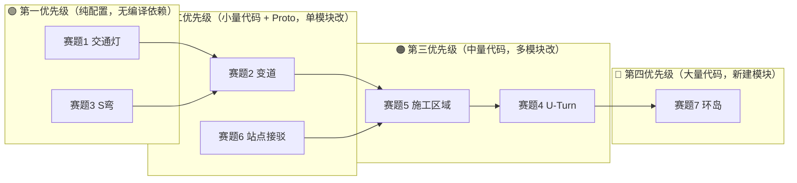

# Apollo 星火自动驾驶大赛 — 赛题↔模块映射矩阵

> 生成时间：2026-06-16

---

## 一、赛题 ↔ Apollo 模块映射矩阵

| 赛题 | Scenario | TrafficRule | Task | Planner | OpenSpace | 其他 |
|------|----------|-------------|------|---------|-----------|------|
| 1. 交通灯 | **traffic_light_unprotected_right_turn**<br/>traffic_light_protected | **traffic_light** | — | PublicRoadPlanner | — | routing (GetPathTurnType) |
| 2. 变道 | lane_follow | backside_vehicle<br/>speed_setting | **lane_change_path**<br/>lane_follow_path | PublicRoadPlanner | — | routing (变道路由) |
| 3. S弯 | lane_follow<br/>(large_curvature) | speed_setting | path_bounds_decider<br/>**obstacle_nudge_decider**<br/>speed_bounds_decider | PublicRoadPlanner | — | planning.conf |
| 4. U-Turn | **large_curvature** (扩展) | — | **open_space_roi_decider_park**<br/>open_space_trajectory_provider | PublicRoadPlanner | **Hybrid A\*<br/>FemPosDeviation** | prediction (对向来车) |
| 5. 施工区域 | lane_follow | speed_setting | **lane_borrow_path** | PublicRoadPlanner | — | perception (锥桶) |
| 6. 站点接驳 | **pull_over** (扩展) | destination<br/>speed_setting | pull_over_path<br/>lane_follow_path<br/>fallback_path<br/>path_decider<br/>speed_bounds_decider<br/>piecewise_jerk_speed | PublicRoadPlanner | — | ~~park_and_go~~ ❌ 不可用<br/>（需 CITY_DRIVING 外） |
| 7. 环岛 | **roundabout** (新建) | stop_sign<br/>backside_vehicle<br/>speed_setting | lane_follow_path<br/>lane_borrow_path<br/>obstacle_nudge_decider | PublicRoadPlanner | — | HDMap<br/>routing<br/>GeoFence |

> **粗体** = 核心模块，改动最大

---

## 二、需要新建的模块清单

| 模块 | 路径 | 说明 | 赛题 |
|------|------|------|------|
| RoundaboutScenario | `modules/planning/scenarios/roundabout/` | 环岛场景入口/切换/退出 | 7 |
| StageEntry | `modules/planning/scenarios/roundabout/stage_entry.{h,cc}` | 入口停车让行+蠕行 | 7 |
| StageCirculating | `modules/planning/scenarios/roundabout/stage_circulating.{h,cc}` | 环内限速行驶 | 7 |
| StageExit | `modules/planning/scenarios/roundabout/stage_exit.{h,cc}` | 出口转向灯+后方观察 | 7 |
| RoundaboutContext | `modules/planning/scenarios/roundabout/context.h` | 场景上下文 | 7 |
| Roundabout Proto | `modules/planning/scenarios/roundabout/proto/roundabout.proto` | 场景配置 Proto | 7 |
| Roundabout Pipeline | `modules/planning/scenarios/roundabout/conf/pipeline.pb.txt` | Stage Task 链 | 7 |
| Roundabout Plugin | `modules/planning/scenarios/roundabout/plugins.xml` | CyberRT 插件注册 | 7 |
| StageWaiting | `modules/planning/scenarios/pull_over/stage_waiting.{h,cc}` | 5秒静止等待 | 6 |
| StageDeparture | `modules/planning/scenarios/pull_over/stage_departure.{h,cc}` | 站点驶离 | 6 |
| GeoFence Config | `profiles/default/.../roundabout/conf/geofence.pb.txt` | 环岛区域配置文件 | 7 |

---

## 三、需要修改的模块清单

| 模块 | 路径 | 改动类型 | 说明 | 赛题 |
|------|------|----------|------|------|
| LaneChangePath | `modules/planning/tasks/lane_change_path/lane_change_path.cc` | 代码修改 | 新增变道限速 `SetCruiseSpeed(8.33)` | 2 |
| LaneChangePath Proto | `modules/planning/tasks/lane_change_path/proto/lane_change_path.proto` | Proto 新增 | 新增安全距离配置字段 | 2 |
| LaneBorrowPath | `modules/planning/tasks/lane_borrow_path/lane_borrow_path.{h,cc}` | 代码修改 | 移植旧版施工区域逻辑 | 5 |
| LaneBorrowPath Proto | `modules/planning/tasks/lane_borrow_path/proto/lane_borrow_path.proto` | Proto 新增 | 施工区参数字段 | 5 |
| OpenSpaceRoiDeciderPark | `modules/planning/tasks/open_space_roi_decider_park/open_space_roi_decider_park.{h,cc}` | 代码修改 | NARROW_STREET_U_TURN case 分支 | 4 |
| OpenSpaceRoiDeciderPark Proto | `modules/planning/tasks/open_space_roi_decider_park/proto/open_space_roi_decider_park.proto` | Proto 新增 | u_turn_max_forward_v 等字段 | 4 |
| LargeCurvatureScenario | `modules/planning/scenarios/large_curvature/large_curvature_scenario.{h,cc}` | 代码修改 | IsTransferable 增加 U-Turn 触发 | 4 |
| StageLargeCurvature | `modules/planning/scenarios/large_curvature/stage_large_curvature.cc` | 代码修改 | 对向来车检测 + 终点航向收敛 | 4 |
| PullOverStageApproach | `modules/planning/scenarios/pull_over/stage_approach.cc` | 代码修改 | LimitCruiseSpeed(8.33) + 跳转 WAITING | 6 |
| PullOver Proto | `modules/planning/scenarios/pull_over/proto/pull_over.proto` | Proto 新增 | waiting_duration, station_speed_limit | 6 |
| PullOverScenario | `modules/planning/scenarios/pull_over/pull_over_scenario.cc` | 代码修改 | 注册新 Stage | 6 |
| BacksideVehicle | `modules/planning/traffic_rules/backside_vehicle/backside_vehicle.cc` | 代码修改 | 增加 roundabout_exit 模式 | 7 |
| PlanningStatus Proto | `modules/planning/planning_base/proto/planning_status.proto` | Proto 新增 | RoundaboutStatus message | 7 |
| LaneChangeUtil | `modules/planning/planning_interface_base/task_base/common/lane_change_util/lane_change_util.cc` | 代码修改 | 同步安全距离参数（消除代码重复） | 2 |

---

## 四、仅需配置变更的模块清单

| 配置项 | 路径 | 改动 | 赛题 |
|--------|------|------|------|
| 场景列表 | `profiles/default/.../public_road_planner_config.pb.txt` | 取消注释 traffic_light 场景，注册 roundabout | 1, 7 |
| 交通规则列表 | `profiles/default/.../traffic_rule_config.pb.txt` | 确认 speed_setting 在列表中 | 5, 7 |
| 红绿灯停车距离 | `profiles/default/.../traffic_light/conf/default_conf.pb.txt`（新建） | `stop_distance: 1.75` | 1 |
| 红灯右转 | `profiles/default/.../unprotected_right_turn/conf/scenario_conf.pb.txt`（新建） | `enable_right_turn_on_red: true` | 1 |
| 红绿灯 Pipeline | `profiles/default/.../unprotected_right_turn/conf/pipeline.pb.txt`（新建） | 从模块目录复制 | 1 |
| 变道参数 | `modules/planning/tasks/lane_change_path/conf/default_conf.pb.txt` | freeze_time=5.0, 安全距离参数 | 2 |
| 曲率限速 | `modules/planning/tasks/speed_bounds_decider/conf/default_conf.pb.txt` | `max_centric_acceleration_limit: 2.0` | 3 |
| 全局规划参数 | `profiles/default/.../planning.conf` | `planning_upper_speed_limit=8.33`, nudge buffer gflags | 3 |
| Nudge 参数 | `modules/planning/tasks/obstacle_nudge_decider/conf/default_conf.pb.txt` | 增大 nudge buffer | 3, 7 |
| PullOver 路径 | `modules/planning/tasks/pull_over_path/conf/` | `pull_over_road_edge_buffer: 0.3` | 6 |
| PullOver 场景 | `modules/planning/scenarios/pull_over/conf/scenario_conf.pb.txt` | 停车精度参数 | 6 |
| PullOver Pipeline | `modules/planning/scenarios/pull_over/conf/pipeline.pb.txt` | 插入 WAITING + DEPARTURE Stage | 6 |
| OpenSpace 规划器 | `modules/planning/planning_open_space/proto/planner_open_space_config.proto` | 搜索节点数、gear switch penalty | 4 |
| 环岛场景 | `modules/planning/scenarios/roundabout/conf/scenario_conf.pb.txt`（新建） | 场景参数 | 7 |
| 环岛 Pipeline | `modules/planning/scenarios/roundabout/conf/pipeline.pb.txt`（新建） | Stage Task 链 | 7 |
| 施工区参数 | `modules/planning/tasks/lane_borrow_path/conf/default_conf.pb.txt` | 施工区参数 | 5 |
| 后方来车检测 | `modules/planning/traffic_rules/backside_vehicle/conf/default_conf.pb.txt` | `backside_lane_width: 3.5` | 2 |

---

## 五、参数变更汇总表（全局视图）

| 参数 | 当前值 | 新值 | 影响赛题 |
|------|--------|------|----------|
| `planning_upper_speed_limit` | 20.00 | 8.33 | 2, 3, 4, 5, 6, 7 |
| `default_cruise_speed` | 11.18 | 8.33 | 2, 3 |
| `max_centric_acceleration_limit` | 0.8 | 2.0 | 3 |
| `static_obstacle_nudge_l_buffer` | 0.3 | 0.6→1.0 | 3, 5, 7 |
| `obstacle_lat_buffer` | 0.4 | 0.6 | 3, 5 |
| `stop_distance` (traffic_light) | 1.0 | 1.75 | 1 |
| `enable_right_turn_on_red` | false | true | 1 |
| `change_lane_success_freeze_time` | 3.0 | 5.0 | 2 |
| `pull_over_road_edge_buffer` | 0.15 | 0.3 | 6 |
| `max_forward_v` (open_space) | 2.0 | 5.0 (U-Turn 专用) | 4 |
| `max_explored_num` (Hybrid A*) | 10000 | 20000 | 4 |

---

## 六、修改优先级和依赖关系



### 依赖说明

| 依赖关系 | 原因 |
|----------|------|
| P1, P3 无依赖 | 纯配置，可直接修改 |
| P2 依赖 P3 | 变道限速需要 `planning_upper_speed_limit` 已设为 8.33 |
| P5 依赖 P2 | 施工区限速与变道限速共用全局速度上限 |
| P6 依赖 P5 的基础 | PullOver 的 stage 框架修改经验可复用到施工区移植 |
| P4 依赖 P5 | OpenSpace 参数调整经验可参考施工区的 ReferenceLine 限速方案 |
| P7 依赖 P4 | 环岛的入口停车让行逻辑需要参考 U-Turn 的对向来车检测 |

---

## 七、编译依赖图

```
planning_component (所有赛题共享)
├── planning.conf (P1, P3 配置)
├── public_road_planner_config.pb.txt (P1, P7 场景注册)
├── traffic_rule_config.pb.txt (P5, P7)
│
├── traffic_rules/
│   ├── traffic_light/ (P1 纯配置)
│   └── backside_vehicle/ (P2 配置 + P7 代码改)
│
├── tasks/
│   ├── lane_change_path/ (P2 Proto 改 + 代码改)
│   ├── lane_borrow_path/ (P5 Proto 改 + 代码改)
│   ├── speed_bounds_decider/ (P3 纯配置)
│   ├── obstacle_nudge_decider/ (P3, P7 配置)
│   ├── pull_over_path/ (P6 配置)
│   └── open_space_roi_decider_park/ (P4 Proto 改 + 代码改)
│
├── scenarios/
│   ├── traffic_light_unprotected_right_turn/ (P1 纯配置)
│   ├── traffic_light_protected/ (P1 纯配置)
│   ├── large_curvature/ (P4 代码改)
│   ├── pull_over/ (P6 新增 Stage + Proto 改)
│   └── roundabout/ (P7 新建全部) ← 最大编译开销
│
└── planning_open_space/ (P4 配置)
```

---

## 八、建议开发顺序

1. **先做 P1 + P3**（纯配置，零编译，0.5 天验证）
2. **再做 P2**（LaneChangePath proto 改动，1 天）
3. **再做 P6**（PullOver 新增 Stage，1-2 天）
4. **再做 P5**（LaneBorrowPath 移植，2-3 天）
5. **再做 P4**（OpenSpace U-Turn，2-3 天）
6. **最后做 P7**（Roundabout 新建，5-7 天）

> **总计预估**：12-18 人天（不含编译和测试时间）
