# Apollo PnC 日志系统重构方案

> 生成时间：2026-06-16 | 基于 6 个子 Agent 深度分析 + 3 轮交叉审查
> 覆盖范围：`modules/planning/` ~779 源文件 / ~130,976 行 / 2,818 处日志宏调用

---

## 目录

- [一、现状诊断](#一现状诊断)
  - [1.1 日志基础设施全貌](#11-日志基础设施全貌)
  - [1.2 日志密度热力图](#12-日志密度热力图)
  - [1.3 冗余日志模式总结](#13-冗余日志模式总结)
- [二、日志分层设计](#二日志分层设计)
  - [2.1 关键决策点矩阵](#21-关键决策点矩阵)
  - [2.2 六层日志模型](#22-六层日志模型)
  - [2.3 不同场景的日志策略](#23-不同场景的日志策略)
- [三、系统架构设计](#三系统架构设计)
  - [3.1 方案对比与选型](#31-方案对比与选型)
  - [3.2 日志宏体系设计](#32-日志宏体系设计)
  - [3.3 目录结构设计](#33-目录结构设计)
  - [3.4 JSON 格式规范](#34-json-格式规范)
  - [3.5 配置方式](#35-配置方式)
- [四、日志过滤与分析工具](#四日志过滤与分析工具)
- [五、实施计划](#五实施计划)
- [附录](#附录)

---

## 一、现状诊断

### 1.1 日志基础设施全貌

#### GLog 初始化链路

```
cyber_launch (Python) → mainboard (C++ binary)
  → google::InitGoogleLogging(argv[0])
  → 加载 global_flagfile.txt (--log_dir, --minloglevel, ...)
  → 加载 planning.conf 覆盖参数
  → PlanningComponent::Init() → AINFO 可用
```

**关键发现**：
- `PlanningComponent` **不直接调用** `InitGoogleLogging`，初始化由 CyberRT `mainboard` 完成
- `planning_gflags.cc` 中有 4 个日志输出控制 gflags：
  - `FLAGS_enable_record_debug`（默认 true）— 控制 proto 调试数据
  - `FLAGS_enable_print_curve`（默认 false）— 控制曲线点日志
  - `FLAGS_enable_print_edge_follow_log`（默认 false）— 边缘跟随日志
  - `FLAGS_enable_osqp_debug`（默认 false）— OSQP 调试日志
- `planning.conf` 本身无日志参数，继承自 `global_flagfile.txt`
- GLOG 环境变量实际控制行为：`GLOG_max_log_size=500`（500MB 轮转）、`GLOG_minloglevel=0`、`GLOG_alsologtostderr=0`

#### Apollo 日志宏体系

```cpp
// cyber/common/log.h (间接封装 glog)
#define AINFO    LOG(INFO)      // GLOG severity 0
#define AWARN    LOG(WARNING)   // GLOG severity 1
#define AERROR   LOG(ERROR)     // GLOG severity 2
#define AFATAL   LOG(FATAL)     // GLOG severity 3 (会 abort)
#define ADEBUG   LOG(INFO)      // 实际等于 INFO，release 构建中被 -c opt 排除
```

**与原生 GLOG 对比**：Apollo 宏与原生 GLOG 格式完全一致，无额外封装（无模块前缀自动添加、无结构化字段）。

**实际日志行格式**：
```
I0616 09:52:48.198967 50423 scenario_manager.cc:68] switch scenario from ...
│  │  │             │     │                      │
│  │  │             │     │                      └─ 消息体
│  │  │             │     └─ 文件名:行号
│  │  │             └─ 线程ID
│  │  └─ 微秒时间戳
│  └─ 月日
└─ 级别: I=INFO W=WARNING E=ERROR F=FATAL
```

**🚨 反模式发现**：`scenarios/square/extricate_stage.cc:35` 中存在：
```cpp
#define AINFO AERROR  // 将所有 AINFO 强制升级为 AERROR！调试遗留代码
```
此宏导致该文件中所有 `AINFO <<` 实际输出为 ERROR 级别，应立即修复。

#### 日志文件命名与轮转

- **命名规则**：`<module>.log.INFO.YYYYMMDD-HHMMSS.PID`
  - 示例：`planning.log.INFO.20260616-112833.622162`
- **符号链接**：`planning.INFO → planning.log.INFO.<latest>`
- **轮转配置**：`GLOG_max_log_size=500MB`，超过 500MB 创建新文件
- **无自动清理**：历史日志无限增长（观察到 2 天积累 244 文件 / ~1GB）
- **14 个模块独立写文件**：planning、control、prediction、routing、map、monitor 等

#### 当前日志系统问题清单

| 问题 | 严重度 | 详情 |
|------|:---:|------|
| 文件过多无清理 | 🔴 | 244 文件 / ~1GB，无 logrotate/cron |
| planning.INFO 过大 | 🔴 | 单文件 50MB+，编辑器无法打开 |
| 纯文本无结构 | 🔴 | 无法按 scenario/frame/level 过滤 |
| ADEBUG 在 release 丢失 | 🔴 | 43% 日志在比赛环境中静默消失 |
| 无帧间关联 | 🟡 | 缺少 frame_id 等关联字段 |
| 日志不均衡 | 🟡 | 核心调度器 3 条 vs 借道任务 100+ 条 |
| `#define AINFO AERROR` 反模式 | 🔴 | extricate_stage.cc 调试遗留代码 |

---

### 1.2 日志密度热力图

#### 模块级日志统计

| 子模块 | 文件数 | 代码行(估) | AINFO | ADEBUG | AWARN | AERROR | 总数 | 密度(条/百行) |
|--------|:---:|:---:|:---:|:---:|:---:|:---:|:---:|:---:|
| **tasks** | 138 | ~27,000 | ~220 | ~240 | ~25 | ~260 | **~745** | **2.76** 🔥 |
| **planning_interface_base** | 53 | ~4,500 | ~35 | ~30 | ~5 | ~50 | **~120** | **2.67** |
| **scenarios** | 178 | ~12,000 | ~100 | ~120 | ~5 | ~85 | **~310** | **2.58** |
| **planning_component** | 14 | ~3,700 | ~26 | ~23 | ~4 | ~17 | **~70** | **1.89** |
| **traffic_rules** | 29 | ~2,300 | ~0 | ~45 | ~3 | ~7 | **~55** | **2.39** |
| **planners/public_road** | 6 | ~350 | 3 | 0 | 0 | 0 | **3** | **0.86** ⚠️ |
| **planning_base** | 200 | ~34,131 | ~80 | ~100 | ~15 | ~85 | **~280** | **0.82** |

#### 🔥 关键发现

1. **`public_road_planner.cc` — 核心规划器零日志！**
   - 作为处理全部 17 个场景的主 Planner，完全没有日志
   - 无法追踪场景切换、规划失败、后备触发
   - **建议添加 5-8 条战略性日志**

2. **`scenario_manager.cc` — 仅 3 条日志**
   - Init (Load scenario list)、switch scenario、Reset to default
   - 缺少：IsTransferable 未命中、场景切换失败、默认场景为空
   - 全都是 AINFO，无 AERROR/AWARN

3. **日志密度不均衡 — "上疏下密"**
   ```
   核心调度层:  public_road_planner (0) + scenario_manager (3) = 极稀疏
   任务执行层:  lane_borrow_path_generic (100+) + path_bounds_decider (55) = 极密集
   ```

#### Top 10 日志最密集文件

| # | 文件 | 日志数 | 密度 | 主要问题 |
|---|------|:---:|:---:|------|
| 1 | `scenarios/lane_follow_park/lane_follow_park_stage.cc` | ~55 | 12.79 | 64% 可删除（逐障碍物 DebugString） |
| 2 | `scenarios/lane_follow_park/lane_escape_park_stage.cc` | ~18 | 10.59 | 过度详细的空间间隙日志 |
| 3 | `planning_base/common/obstacle_blocking_analyzer.cc` | ~35 | 8.75 | 32 条 ADEBUG 循环内障碍物分析 |
| 4 | `planning_component/planning_base.cc` | ~12 | 8.00 | 全 AINFO，可降级 |
| 5 | `planning_base/common/smoothers/smoother.cc` | ~9 | 8.18 | 混合错误+调试日志 |
| 6 | `tasks/lane_borrow_path_generic/lane_borrow_path_generic.cc` | **100+** | **>11.6** | **最高绝对数量，54% 可降级** |
| 7 | `planners/navi/navi_planner.cc` | ~35 | 7.61 | 高错误日志密度 |
| 8 | `planners/lattice/lattice_planner.cc` | ~28 | 7.57 | 25 条 ADEBUG |
| 9 | `planning_component/integration_tests/planning_test_base.cc` | ~20 | 7.41 | 18 条 AERROR（测试文件） |
| 10 | `traffic_rules/keepclear/keep_clear.cc` | ~15 | 6.00 | 13 条 ADEBUG |

---

### 1.3 冗余日志模式总结

| # | 冗余模式 | 示例 | 频率 | 建议 |
|---|---------|------|:---:|------|
| 1 | **循环内逐障碍物打印** | `AINFO << obstacle->DebugString()` per obstacle | 极高 | 改为聚合统计或 VLOG(3) |
| 2 | **每帧无变化状态日志** | `AINFO << "path reusable"`、`"No need to borrow lane"` | 高 | 仅在状态变化时打印，或改为 `_EVERY_N(100)` |
| 3 | **循环内逐字段打印** | RSS decider 每帧 14 个 ADEBUG 字段 | 高 | 合并为 1 条条件日志 |
| 4 | **函数入口/出口日志** | `AINFO << "Enter xxx"`、`"Exit xxx"` | 中 | 删除，用 perf trace 替代 |
| 5 | **重复打印相同信息** | RSS decider: `is_rss_safe` 和 `cur_dist_lon` 各打印两次 | 低 | 删除重复，修复 bug |
| 6 | **`#define AINFO AERROR` 强制升级** | extricate_stage.cc:35 | 极低但严重 | **立即修复** |
| 7 | **打印整个 proto DebugString** | `AINFO << planner_config.DebugString()` | 中 | 截断或降级为 VLOG |

---

## 二、日志分层设计

### 2.1 关键决策点矩阵

| 决策点 | 所在文件 | 当前日志 | 应记录的最小信息 | 优先级 |
|--------|----------|----------|-------------------|:---:|
| **场景切换** | `scenario_manager.cc` | 3 处 AINFO | `[frm]` 从 X→Y，IsTransferable=true，原因 | 🔴 |
| **IsTransferable 判断** | 各 scenario `.cc` | ADEBUG（多数缺失） | 返回 true/false + 判断依据（距离、重叠类型） | 🔴 |
| **TrafficRule 决策** | `traffic_decider.cc` | 仅 `"Applied rule X"` ADEBUG | 规则名 + 是否产生停止墙 + 停止位置/类型 | 🔴 |
| **Stage 切换** | `scenario.cc` | AINFO（部分） | Stage A→B，原因 FINISHED/ERROR | 🟡 |
| **Task 执行结果** | `stage.cc` | AINFO 性能计时 | Task 名 + 成功/失败 + 关键输出值 | 🟡 |
| **Planner 入口** | `public_road_planner.cc` | **零日志！** | 当前场景/Stage、规划状态、耗时 | 🔴 |
| **帧开始/结束** | `on_lane_planning.cc` | 2 条 AINFO | ✅ 已有，但中间缺少上下文 | 🟢 |
| **规划目标** | `traffic_decider.cc` | ADEBUG | 最终 min_s + 停止原因 + 类型(硬/软) | 🟡 |

### 2.2 六层日志模型

```
┌─────────────────────────────────────────────────────────────┐
│  Layer 5: TRACE    │ 每帧 ~500 行  │ 开发模式 │ 仅 DEV     │
│  Layer 4: STATE    │ 每帧 ~10 行   │ 状态机变化│ 始终       │
│  Layer 3: DECISION │ 每帧 ~8 行    │ 决策详情  │ 始终       │
│  Layer 2: SUMMARY  │ 每帧 ~1 行    │ 帧摘要    │ 始终       │
│  Layer 1: ERROR    │ 按需          │ 规划失败  │ 始终       │
│  Layer 0: FATAL    │ 按需          │ 进程崩溃  │ 始终       │
└─────────────────────────────────────────────────────────────┘
```

#### Layer 0: FATAL（程序崩溃）
- **内容**：CHECK 失败、段错误、未处理异常
- **输出**：`data/log/planning.FATAL`（独立文件）
- **启用**：始终

#### Layer 1: ERROR（规划失败）
- **内容**：状态失败、空引用线、任务错误、轨迹不可行、规划超时
- **输出**：`data/log/planning.ERROR`（独立文件）
- **启用**：始终
- **示例**：`[f=1234][scn=lane_follow][stg=LANE_FOLLOW_STAGE] Reference line is empty`

#### Layer 2: SUMMARY（每帧一行）⭐ 核心创新
- **内容**：帧 ID + 场景 + Stage + 速度 + 轨迹点数 + 耗时 + 决策摘要
- **输出**：`data/log/planning/summary.log`（JSON Lines）
- **启用**：始终（AINFO 级别）
- **精确格式**：
```
[f={frame_id}][scenario={name}][stage={name}][v={speed}m/s][traj={n}pts/{t}s][plan_t={ms}ms][decision={action}][stop={reason}:{dist}m][status={result}]
```
- **示例**：
```
[f=1234][scenario=lane_follow][stage=LANE_FOLLOW_STAGE][v=8.3m/s][traj=50pts/8.0s][plan_t=63ms][decision=straight][stop=none][status=OK]
[f=5678][scenario=stop_sign_unprotected][stage=PRE_STOP][v=5.1m/s][traj=45pts/6.0s][plan_t=78ms][decision=stop][stop=stop_sign:42m][status=OK]
```

#### Layer 3: DECISION（决策详情）
- **内容**：IsTransferable 结果、每条 TrafficRule 决策、Task 输出摘要、路径决策
- **输出**：`data/log/planning/decision.log`（JSON Lines）
- **启用**：始终（AINFO 级别）
- **示例**：
```
[f=1234][D] IsTransferable: lane_follow→stop_sign_unprotected = TRUE (dist=42.3m < 50m)
[f=1234][D] IsTransferable: lane_follow→traffic_light_protected = FALSE (no SIGNAL overlap)
[f=1234][D] traffic_rule[crosswalk] = add_stop(id=crosswalk_1, s=85.2m, type=HARD)
[f=1234][D] task[PathBoundsDecider] = OK (path_boundary_size=120)
[f=1234][D] planning_target: STOP (reason=STOP_SIGN, s=42.3m, type=HARD)
```

#### Layer 4: STATE（状态机变化）
- **内容**：场景进入/退出、Stage 转换、PlanningContext 变更
- **输出**：`data/log/planning/decision.log`
- **启用**：始终
- **示例**：
```
[f=1234][S] SCENARIO_ENTER: stop_sign_unprotected (overlap=stop_123, dist=42.3m)
[f=1234][S] STAGE_TRANSITION: PRE_STOP → STOP (reason=FINISHED)
[f=1240][S] SCENARIO_RESET → lane_follow (reason=DEFAULT_SCENARIO)
```

#### Layer 5: TRACE（完整数据）
- **内容**：所有 ReferenceLine、障碍物、路径点、ST 图（开发模式）
- **输出**：`data/log/planning/trace/`（JSON Lines + PlanningData Proto）
- **启用**：`FLAGS_enable_planning_trace=true`（默认 false）

### 2.3 不同场景的日志策略

| 场景 | 建议层级 | 预估日志量 | 说明 |
|------|:---:|:---:|------|
| **正常仿真调试** | Layer 1-3 | ~12 行/帧 | SUMMARY 1行 + DECISION ~10行 + ERROR 按需 |
| **场景开发调试** | Layer 1-5 | ~500 行/帧 | 全量日志，配合 DreamView 可视化 |
| **线上运行/比赛** | Layer 0-1 | 极少 | 只记录错误，SUMMARY 可剥离 |
| **性能分析** | Layer 0-1 | 极少 | 减少日志开销，性能数据在 proto 中 |
| **远程调试(SSH)** | Layer 1-3 | ~12 行/帧 | 带宽受限，grep 过滤 |
| **CI 回归测试** | Layer 1-4 | ~20 行/帧 | Golden 文件对比 |

---

## 三、系统架构设计

### 3.1 方案对比与选型

| 维度 | A: GLOG 魔改 | **B: 自定义 LogSink** 🏆 | C: spdlog 替换 | D: CyberRT Channel |
|------|:---:|:---:|:---:|:---:|
| **侵入性** | 低 | **极低** — 零调用点修改 | 极高 — 替换全部 2,818 调用 | 中 |
| **性能** | 同步，5-15μs | 同步，5-15μs | 异步，0.5-2μs | 差，20-50μs |
| **结构化支持** | ✅ | ✅ | ✅ | ⚠️ |
| **按场景分流** | ✅ | ✅ | ✅ | ⚠️ |
| **实现复杂度** | 中(~300行) | **低(~400行)** | 极高(~5000+行) | 高(~800行) |
| **向后兼容** | ✅ | ✅ | ❌ | ❌ |
| **可 grep** | ✅ | ✅ | ✅ | ❌ |
| **推荐度** | ⭐⭐⭐ | **⭐⭐⭐⭐⭐** | ⭐ | ⭐⭐ |

**🏆 推荐方案：B — 自定义 LogSink + 路由到场景感知 JSON 文件写入器**

**核心理由**：
1. `google::LogSink::send()` 在所有 glog 宏触发时被调用，**无需修改任何现有 AINFO/AERROR 调用点**
2. 可通过 `thread_local` 上下文注入 scenario/stage/frame_id 等结构化字段
3. 完全控制文件路由：按级别、按场景、按时间片
4. 不修改 `cyber/common/log.h`，与其他 Apollo 模块零冲突
5. 原有 glog 输出（stderr/文件）保持不变，向后兼容

**方案 C 被排除**：替换 2,818 处调用点风险过高
**方案 D 被排除**：CyberRT 消息传输开销不适合高频帧内日志

### 3.2 日志宏体系设计

#### 基础设施宏（新增 header：`planning_base/common/planlog.h`）

```cpp
// ============================================================
// 基础日志宏 — 自动附加 [frm] 前缀
// ============================================================
#define PLAN_LOG(level) \
  LOG(level) << "[frm:" << PlanningLogContext::frame_seq() << "] "

// ============================================================
// 场景感知日志 — 自动附加 [scn] 前缀
// ============================================================
#define PSCENARIO_INFO \
  LOG(INFO) << "[scn:" << PlanningLogContext::scenario_name() << "] "
#define PSCENARIO_WARN \
  LOG(WARNING) << "[scn:" << PlanningLogContext::scenario_name() << "] "

// ============================================================
// Stage 感知日志 — 自动附加 [stg] 前缀
// ============================================================
#define PSTAGE_DEBUG \
  VLOG(1) << "[stg:" << PlanningLogContext::stage_name() << "] "

// ============================================================
// 每帧摘要宏 — 始终写入 summary.log
// ============================================================
#define PFRAME_SUMMARY \
  LOG(INFO) << "[SUMMARY] "

// ============================================================
// 决策日志宏 — 始终写入 decision.log
// ============================================================
#define PDECISION_LOG \
  LOG(INFO) << "[DECISION] "

// ============================================================
// 状态转换日志
// ============================================================
#define PSTATE_LOG \
  LOG(INFO) << "[STATE] "
```

#### Thread-local 上下文

```cpp
struct PlanningLogContext {
  static void set_frame_seq(uint32_t seq);
  static uint32_t frame_seq();

  static void set_scenario_name(const std::string& name);
  static const std::string& scenario_name();

  static void set_stage_name(const std::string& name);
  static const std::string& stage_name();
};
```

#### 插入点

| 函数 | 设置上下文 |
|------|-----------|
| `OnLanePlanning::RunOnce()` 开头 | `PlanningLogContext::set_frame_seq(frame_num)` |
| `ScenarioManager::Update()` 切换后 | `PlanningLogContext::set_scenario_name(scenario->Name())` |
| `Scenario::Process()` Stage 切换后 | `PlanningLogContext::set_stage_name(stage->Name())` |

#### 与现有宏共存

```cpp
#ifdef USE_NEW_LOG
  // 使用新宏系统
  #define PLANNING_INFO_IF_ACTIVE PSCENARIO_INFO
#else
  // 回退到原始 AINFO/AERROR
  #define PLANNING_INFO_IF_ACTIVE AINFO
#endif
```

### 3.3 目录结构设计

```
data/log/planning/                          # 新规划专用日志根目录
├── error.log                               # AERROR + AFATAL（小文件 <100KB/h）
├── summary.log                             # PFRAME_SUMMARY 每帧一行 JSON
│                                           #   ~300B/帧 × 10Hz ≈ 11MB/h
│                                           #   保留 24h
├── decision.log                            # PDECISION_LOG + PSTATE_LOG
│                                           #   ~5KB/s ≈ 18MB/h
│                                           #   保留 7 天
├── trace/                                  # 完整日志（开发模式，按时段切分）
│   ├── 20260616_0951_trace.jsonl           #   每 10 分钟轮转
│   ├── 20260616_1001_trace.jsonl
│   └── ...
│                                           #   保留 1h（可配置）
└── per_scenario/                           # 按场景分文件（竞赛分析用）
    ├── lane_follow.jsonl
    ├── stop_sign.jsonl
    ├── traffic_light.jsonl
    ├── crosswalk.jsonl
    ├── pull_over.jsonl
    ├── bare_intersection.jsonl
    ├── yield_sign.jsonl
    └── emergency.jsonl
                                            #   不自动删除
```

**保留策略**：
- `error.log`：30 天
- `summary.log`：24 小时
- `decision.log`：7 天
- `trace/*.jsonl`：1 小时（可配置）
- `per_scenario/*.jsonl`：手动管理

### 3.4 JSON 格式规范

#### 完整日志条目（trace / per_scenario）

```json
{
  "ts": "2026-06-16T09:52:47.607Z",
  "lvl": "INFO",
  "mod": "planning",
  "sub": "on_lane_planning",
  "scn": "lane_follow",
  "stg": "LANE_FOLLOW_STAGE",
  "frm": 12345,
  "src": {
    "file": "on_lane_planning.cc",
    "line": 330,
    "func": "RunOnce"
  },
  "tid": 243679,
  "msg": "Planning start frame sequence id = [12345]",
  "dat": {
    "speed": 8.3,
    "accel": -0.5,
    "traj_points": 200,
    "planning_time_ms": 15.2,
    "obstacle_count": 3
  }
}
```

#### 摘要条目（summary.log）

```json
{
  "ts": "2026-06-16T09:52:47.607Z",
  "frm": 12345,
  "scn": "lane_follow",
  "stg": "LANE_FOLLOW_STAGE",
  "dat": {
    "status": "ok",
    "speed": 8.3,
    "traj_pts": 200,
    "plan_time_ms": 15.2,
    "ref_line_cnt": 1,
    "obs_cnt": 3,
    "replan": false
  }
}
```

#### 架构组件图

```mermaid
graph TB
    subgraph "现有 glog 管道（保持不变）"
        AINFO["AINFO << msg"]
        AERROR["AERROR << msg"]
        ADEBUG["ADEBUG << msg"]
    end

    subgraph "新增: PlanningLogSink"
        SINK["PlanningLogSink : google::LogSink"]
        CTX["PlanningLogContext (thread_local)"]
        ROUTER["LogRouter"]
    end

    subgraph "文件写入器"
        ERR["ErrorWriter → error.log"]
        SUM["SummaryWriter → summary.log"]
        DEC["DecisionWriter → decision.log"]
        TRACE["TraceWriter → trace/*.jsonl"]
        SCEN["PerScenarioWriter → per_scenario/*.jsonl"]
    end

    subgraph "上下文提供者"
        PC["PlanningComponent::Proc()"]
        SM["ScenarioManager::Update()"]
        ST["Stage::Process()"]
    end

    AINFO --> SINK
    AERROR --> SINK
    ADEBUG --> SINK

    PC -->|set_frame_seq| CTX
    SM -->|set_scenario_name| CTX
    ST -->|set_stage_name| CTX

    SINK -->|读取上下文| CTX
    SINK -->|序列化为 JSON| ROUTER
    ROUTER -->|按级别| ERR
    ROUTER -->|按标签| SUM
    ROUTER -->|按标签| DEC
    ROUTER -->|全部| TRACE
    ROUTER -->|按场景| SCEN
```



### 3.5 配置方式

#### 新增 gflags（`planning_gflags.cc`）

```cpp
DEFINE_bool(planning_log_json, true,
            "Enable JSON structured logging output");
DEFINE_bool(planning_log_per_scenario, false,
            "Enable per-scenario log file routing");
DEFINE_int32(planning_log_level, 1,
             "Planning log level: 0=FATAL, 1=ERROR, 2=SUMMARY, "
             "3=DECISION, 4=STATE, 5=TRACE");
DEFINE_string(planning_log_dir, "data/log/planning",
              "Planning log output directory");
DEFINE_int32(planning_log_trace_rotate_minutes, 10,
             "Trace log rotation interval in minutes");
```

#### planning.conf 覆盖

```
# 新增日志配置
--planning_log_json=true
--planning_log_level=3
--planning_log_dir=data/log/planning
```

#### 运行时动态切换（Phase 4）

通过 CyberRT Channel 发送 `LogLevelCommand` 消息，实现不停机切换日志级别。

---

## 四、日志过滤与分析工具

### 4.1 现有工具摸底

| 工具 | 位置 | 状态 | 可复用度 |
|------|------|------|:---:|
| `log_util.py` | `.oldcode/.../tools/` | 日志解析基础库 | ⭐⭐⭐ 高 |
| `planning_task_stats.py` | `.oldcode/.../tools/` | 从 record 提取 Task 耗时 | ⭐⭐⭐ 高 |
| `plot_log.py` | `.oldcode/.../tools/` | matplotlib 日志可视化 | ⭐⭐ 中 |
| `plot_planning_perf.py` | `.oldcode/.../tools/` | 性能时间线 | ⭐⭐⭐ 高 |

**结论**：当前 workspace 无生产级工具，`.oldcode/` 中的工具依赖旧格式且缺 CLI 统一入口。

### 4.2 `planlog` CLI 工具设计

#### 核心命令

```bash
# ===== 过滤 =====
planlog --scenario stop_sign_unprotected planning.log    # 按场景
planlog --frame 12345 planning.log                       # 按帧号
planlog --frame-range 100-200 planning.log               # 按帧范围
planlog --level ERROR,WARN planning.log                  # 按级别
planlog --scenario lane_follow --level ERROR planning.log # 组合过滤

# ===== 统计 =====
planlog --errors planning.log                            # 错误摘要（按类型分组）
planlog --scenario-stats planning.log                    # 场景统计（帧数、耗时）
planlog --perf planning.log                              # 性能统计（min/avg/max/p99）

# ===== 可视化 =====
planlog --timeline planning.log                          # 场景切换 ASCII 时间线
planlog --latency-chart planning.log                     # 规划耗时趋势

# ===== 导出 =====
planlog --csv planning.log                               # 导出 CSV
planlog --csv --scenario stop_sign planning.log          # 按场景导出

# ===== 实时 =====
planlog --follow planning.log                            # tail -f 模式
planlog --follow --alert planning.log                    # 异常告警模式
```

#### 示例输出

**`planlog --scenario-stats`**：
```
╭──────────────────────────────┬─────────┬──────────┬─────────────────────╮
│ Scenario                     │  Frames │  Avg(ms) │  Duration           │
├──────────────────────────────┼─────────┼──────────┼─────────────────────┤
│ LANE_FOLLOW                  │    2340 │     8.2  │  10:00:05 → 10:00:38│
│ STOP_SIGN_UNPROTECTED        │     420 │    25.1  │  10:00:38 → 10:00:42│
│ TRAFFIC_LIGHT_PROTECTED      │     180 │    18.3  │  10:01:03 → 10:01:06│
╰──────────────────────────────┴─────────┴──────────┴─────────────────────╯
```

**`planlog --errors`**：
```
╭────────────────────────────────────────────────┬───────┬──────────────────╮
│ Error Pattern                                  │ Count │ First Frame      │
├────────────────────────────────────────────────┼───────┼──────────────────┤
│ Planning failed                                │    12 │ 1234             │
│ failed to init frame                           │     3 │ 1500             │
│ VehicleStateProvider failed                    │     2 │ 3100             │
╰────────────────────────────────────────────────┴───────┴──────────────────╯
```

### 4.3 场景切换 ASCII 时间线

```
Scenario Switching Timeline
════════════════════════════════════════════════════════════════════════════════

[Frame    1] 🟢 LANE_FOLLOW ──────────────────────────────────────────────────▶
[Frame  150]    🟢 STOP_SIGN_UNPROTECTED ──▶ StagePreStop
[Frame  200]                                 ├─ StageStop
[Frame  250]                                 ├─ StageCreep
[Frame  300] ⚠️                                └─ StageIntersectionCruise (⚠️ 1 error)
[Frame  350] 🔴 LANE_FOLLOW ──────────────────────────────────────────────────▶ (🔴 3 errors)

Status: 🟢 Clean  ⚠️ Warning (< 3 errors)  🔴 Error (≥ 3 errors)
Legend: ▶ Scenario start    ├─ Stage transition    ── Running state
```

### 4.4 异常检测脚本

| 检测项 | 方法 | 告警阈值 |
|--------|------|:---:|
| 规划失败率突增 | `AERROR 数 / 总帧数` | > 5% |
| 场景频繁切换（震荡） | 每秒场景切换次数 | > 3 次/秒 |
| Task 超时 | 单 Task 耗时 | > 100ms |
| 轨迹跳变 | 相邻帧轨迹终点距离 | > 5m |
| 速度异常 | 规划速度与实际速度差 | > 2m/s |

### 4.5 实现方案

- **语言**：Python 3.8+（Click CLI + Rich 终端 + matplotlib 图表）
- **复用**：`.oldcode/tools/log_util.py` 核心解析逻辑
- **架构**：
```
planlog.py                    # CLI 入口 (Click)
├── parsers/                  # glog_parser, json_parser, frame_extractor
├── filters/                  # scenario_filter, frame_filter, level_filter
├── analyzers/                # error_summarizer, perf_analyzer, anomaly_detector
├── visualizers/              # timeline_renderer, chart_renderer
└── exporters/                # csv_exporter
```

---

## 五、实施计划

### 5.1 改动量估算

| 子模块 | AINFO | ADEBUG | AWARN | AERROR | 总调用 | 需改动文件 |
|--------|:---:|:---:|:---:|:---:|:---:|:---:|
| planning_component | 26 | 23 | 4 | 17 | **70** | ~15 |
| planners | 10 | 62 | 2 | 42 | **116** | ~20 |
| scenarios | 102 | 135 | 3 | 117 | **357** | ~55 |
| tasks | 220+ | 240+ | 11 | 192 | **663+** | ~80 |
| traffic_rules | 0 | 45 | 3 | 7 | **55** | ~12 |
| planning_base | 70 | 146 | 37 | 199 | **452** | ~55 |
| planning_interface_base | 64 | 20 | 5 | 41 | **130** | ~20 |
| planning_open_space | 129 | 30 | 5 | 90 | **254** | ~35 |
| pnc_map | 2 | 5 | 0 | 22 | **29** | ~8 |
| park_data_center | 0 | 5 | 0 | 0 | **5** | ~5 |
| **总计** | **623+** | **711+** | **70** | **727** | **~2,131+** | **~305** |

> 注：用户提供总数为 2,818（含 .h 文件和潜在重复计数）。实际有效 .cc 日志调用约 2,100-2,500。

### 5.2 四阶段路线图

```
Phase 1 (1-2天)          Phase 2 (5-7天)           Phase 3 (3-4周)           Phase 4 (1-2周)
┌─────────────────┐     ┌──────────────────┐     ┌──────────────────┐     ┌─────────────────┐
│ 零代码改动        │ ──▶ │ 低侵入性          │ ──▶ │ 全量迁移          │ ──▶ │ 高级特性         │
│ • 配置优化       │     │ • 新宏头文件       │     │ • 替换全部宏       │     │ • 运行时级别切换  │
│ • planlog v0.1  │     │ • LogSink 实现    │     │ • JSON 输出       │     │ • DreamView 集成 │
│ • 立即修复 bug   │     │ • ~50关键点替换    │     │ • planlog v1.0   │     │ • 性能基准测试    │
│                 │     │ • 场景路由         │     │ • 自动化迁移脚本   │     │                  │
└─────────────────┘     └──────────────────┘     └──────────────────┘     └─────────────────┘
```

#### Phase 1: 零代码改动（1-2 天）

**目标**：在不修改 C++ 代码的情况下改善日志可用性。

- [ ] **立即修复** `extricate_stage.cc:35` 的 `#define AINFO AERROR` 反模式
- [ ] 在 `planning.conf` 中添加 GLOG 覆盖参数（`GLOG_minloglevel`、`GLOG_alsologtostderr` 等）
- [ ] 编写 `planlog` v0.1（基于 grep/awk 的 bash 过滤脚本）
- [ ] 添加日志轮转 cron 任务（清理 7 天前的日志）
- [ ] 编写文档 `docs/logging_patterns.md`

**产出**：配置补丁(10行) + planlog.sh(200行) + 文档(400行)
**风险**：🟢 无风险

#### Phase 2: 低侵入性（5-7 天）

**目标**：引入新日志基础设施，在关键路径验证可行性。

- [ ] 新建 `planning_base/common/planlog.h`（~150 行）
- [ ] 实现 `PlanningLogSink : google::LogSink`（~150 行）
- [ ] 添加 `planning_base/common/planlog_context.cc`（thread_local 上下文，~50 行）
- [ ] 添加编译开关 `--define use_new_log=true`（BUILD 文件，~10 行）
- [ ] **替换 ~50 个关键路径日志调用**（~20 文件，~200 行）：
  - `scenario_manager.cc`（3 处，增加至 ~8 处）
  - `public_road_planner.cc`（0→8 处，新增 Planner 入口日志）
  - `scenario.cc` / `stage.cc`（22 处）
  - `planning_component.cc`（13 处）
  - `on_lane_planning.cc`（21 处）
  - `traffic_decider.cc`（4 处，增加决策日志）
- [ ] 实现按场景文件路由

**产出**：~3 新建文件（460 行）+ ~20 文件修改（200 行）
**风险**：🟡 低风险（新旧宏 `#ifdef USE_NEW_LOG` 共存，默认关闭）

#### Phase 3: 全量迁移（3-4 周）

**目标**：替换所有日志调用为新宏，按模块优先级推进。

**迁移批次**：

| 批次 | 子模块 | 日志数 | 工期 |
|:---:|--------|:---:|:---:|
| 1 | `planning_interface_base/` | ~130 | 2 天 |
| 2 | `planning_component/` | ~70 | 1 天 |
| 3 | `planning_base/` | ~452 | 3 天 |
| 4 | `traffic_rules/` | ~55 | 1 天 |
| 5 | `scenarios/` | ~357 | 3 天 |
| 6 | `tasks/` | ~663+ | 4 天 |
| 7 | `planning_open_space/` | ~254 | 2 天 |
| 8 | `planners/` + `pnc_map/` + `park_data_center/` | ~150 | 2 天 |

- [ ] **编写自动化迁移脚本**（Python，sed 批量替换 + 异常处理）
- [ ] 实现 JSON 输出格式
- [ ] 实现 `planlog` v1.0（Python 结构化日志分析工具，~500 行）
- [ ] `.oldcode/` 同步或归档

**产出**：~305 文件修改（~3,000 行替换）+ planlog.py（500 行）
**风险**：🟡 中风险（大范围改动但逐模块可验证）

#### Phase 4: 高级特性（1-2 周）

- [ ] 运行时动态日志级别切换（CyberRT Channel `LogLevelCommand`）
- [ ] DreamView 集成（日志级别面板 + 场景过滤）
- [ ] 性能基准测试（对比新旧系统开销）
- [ ] 日志采样策略（高频路径 N% 采样）
- [ ] 日志压缩与轮转优化

**产出**：~5 文件（~500 行）
**风险**：🟢 低风险（独立于核心迁移）

### 5.3 模块迁移优先级

| 排名 | 子模块 | 优先级 | 理由 |
|:---:|--------|:---:|------|
| 1 | `planners/public_road/` | 🔴 P0 | 核心调度器，3 条日志严重不足，首先迁移建立场景上下文 |
| 2 | `planning_interface_base/` | 🔴 P0 | 基类迁移影响所有派生类 |
| 3 | `planning_component/` | 🔴 P0 | 入口点，帧上下文设置 |
| 4 | `planning_base/common/` | 🟠 P1 | Frame、ReferenceLineInfo 等核心结构 |
| 5 | `planning_base/reference_line/` | 🟠 P1 | 错误排查热点，大量 AERROR |
| 6 | `traffic_rules/` | 🟠 P1 | 55 条日志，迁移成本低收益高 |
| 7 | `scenarios/lane_follow/` | 🟡 P2 | 默认场景，最高频使用 |
| 8 | `tasks/lane_borrow_path/` | 🟡 P2 | 最高 AINFO 密度（100+），迁移收益最大 |
| 9 | `scenarios/` (其余) | 🟢 P3 | 各场景特定逻辑 |
| 10 | `tasks/` (其余) | 🟢 P3 | 其余 Task 插件 |
| 11 | `planning_open_space/` | 🟢 P3 | 独立子系统 |
| 12 | `planners/` (navi/lattice/rtk) | 🟢 P3 | 非主用规划器 |
| 13 | `pnc_map/` + `park_data_center/` | 🟢 P3 | 日志密度极低 |

### 5.4 回滚策略

| 阶段 | 回滚方式 | 影响范围 | 耗时 |
|------|---------|---------|:---:|
| Phase 1 | 还原 planning.conf | 仅配置 | < 1 分钟 |
| Phase 2 | `bazel build --define use_new_log=false`（默认值） | 新宏代码 `#ifdef` 排除 | 无需代码改动 |
| Phase 3 | 逐模块移除 `USE_NEW_LOG` define | 单模块 | 改 1 行 BUILD |
| Phase 4 | 关闭 CyberRT Channel + 移除 DreamView 面板 | 运行时控制功能 | < 5 分钟 |

**全局回滚**：`--define use_new_log=false` 全局关闭，所有代码编译回原始 AINFO/AERROR。

### 5.5 风险矩阵

| 阶段 | 文件改动 | 行数改动 | 风险等级 | 关键风险 | 缓解措施 |
|------|:---:|:---:|:---:|------|------|
| Phase 1 | 2 | ~10 | 🟢 极低 | GLOG flags 行为差异 | 容器内先验证 |
| Phase 2 | ~25 | ~660 | 🟡 低 | LogSink 性能、thread_local 正确性 | 编译开关 + 压测 |
| Phase 3 | ~305 | ~3,500 | 🟡 中 | 替换遗漏、JSON 序列化延迟、编译时间 | 自动化脚本 + 逐模块验证 + CI lint |
| Phase 4 | ~10 | ~500 | 🟢 低 | DreamView 前端集成复杂度 | 独立分支开发 |

---

## 附录

### A. 关键代码位置索引

| 文件 | 用途 |
|------|------|
| `modules/planning/planning_base/gflags/planning_gflags.cc` | Planning gflags 定义 |
| `profiles/default/modules/planning/planning_component/conf/planning.conf` | Planning 配置文件 |
| `modules/planning/planners/public_road/scenario_manager.cc` | 场景管理器（3 处日志） |
| `modules/planning/planners/public_road/public_road_planner.cc` | 核心规划器（0 处日志） |
| `modules/planning/scenarios/lane_follow/lane_follow_scenario.cc` | 默认场景（0 处日志） |
| `modules/planning/planning_interface_base/scenario_base/scenario.cc` | Scenario 基类 |
| `modules/planning/planning_interface_base/scenario_base/stage.cc` | Stage 基类 |
| `modules/planning/planning_interface_base/traffic_rules_base/traffic_decider.cc` | 交通规则调度器 |
| `modules/planning/scenarios/square/extricate_stage.cc:35` | 🚨 `#define AINFO AERROR` 反模式 |
| `modules/planning/tasks/rss_decider/rss_decider.cc:338-360` | RSS decider 重复字段 |
| `.oldcode/Apollo-wzr/modules/planning/planning_base/tools/log_util.py` | 可复用日志解析库 |

### B. 需立即修复的问题

| # | 问题 | 文件 | 修复方式 |
|---|------|------|---------|
| 1 | `#define AINFO AERROR` 反模式 | `scenarios/square/extricate_stage.cc:35` | 删除该宏定义 |
| 2 | RSS decider 重复打印 `is_rss_safe`/`cur_dist_lon` | `tasks/rss_decider/rss_decider.cc:344-347` | 删除重复行 |
| 3 | `scenario_manager.cc` 打印整个 `DebugString()` | `scenario_manager.cc:50` | 改为只打印场景名列表 |
| 4 | 日志无自动清理 | `data/log/` | 添加 cron 任务 |

### C. 相关文档

| 文档 | 路径 |
|------|------|
| 系统架构总览 | `output/ARCHITECTURE.md` |
| 插件开发实战手册 | `output/pnc_dev_handbook.md` |
| Planning Component 分析 | `output/analysis_reports/01_planning_component.md` |
| Interface Base 分析 | `output/analysis_reports/02_planning_interface_base.md` |
| Scenarios 分析 | `output/analysis_reports/04_scenarios.md` |
| Tasks 分析 | `output/analysis_reports/05_tasks.md` |
| Traffic Rules 分析 | `output/analysis_reports/06_traffic_rules.md` |

### D. 审查说明

本文档由 6 个子 Agent 并行分析、3 个审查 Agent 交叉验证后合并而成。审查中发现的关键修正：

1. `planning_gflags.cc` 中存在 4 个日志相关 gflags（非无日志 gflags）
2. GLOG 环境变量 `GLOG_max_log_size=500` 等是重要的基础设施配置
3. `nlohmann_json` 版本为 9.0.0-alpha3（非 3.9.0）
4. `LogSink::send()` 的上下文传递需通过 `thread_local` 实现
5. `extricate_stage.cc` 的反模式需 Phase 1 立即修复
6. `.oldcode/` 代码同步策略需在 Phase 3 明确

---

> **文档状态**：✅ 最终版 | 基于 6 Agent 分析 + 3 Agent 审查 | 2026-06-16
